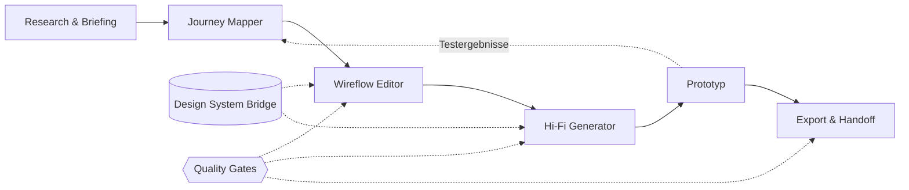
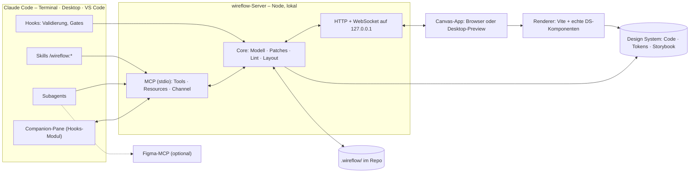
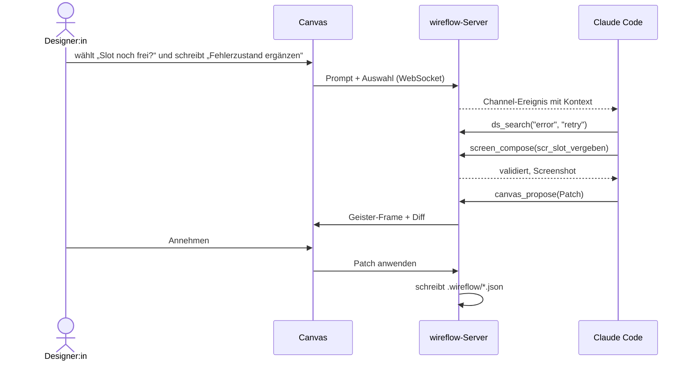
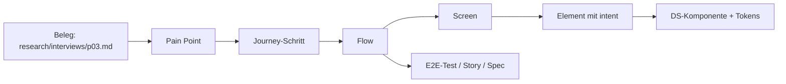

# Wireflow Studio

**Konzept für ein Claude-Code-Plugin: von der User Journey zum klickbaren Hi-Fi-Prototyp – gebaut aus dem eigenen Design System.**

> Status: Konzeptentwurf v0.1 · Stand: 23.11.2026 · „Wireflow Studio“ ist ein Arbeitstitel
> Click-Dummy der Canvas-Oberfläche: [`prototype/index.html`](prototype/index.html) (im Browser öffnen)

---

## Inhalt

1. [Zusammenfassung](#1-zusammenfassung)
2. [Problem und Chance](#2-problem-und-chance)
3. [Vision und Designprinzipien](#3-vision-und-designprinzipien)
4. [Zielgruppen](#4-zielgruppen)
5. [Funktionsumfang](#5-funktionsumfang)
6. [Durchgängiges Beispiel](#6-durchgängiges-beispiel)
7. [UI-Konzept](#7-ui-konzept)
8. [Architektur](#8-architektur)
9. [Datenmodell](#9-datenmodell)
10. [Claude als Co-Designer](#10-claude-als-co-designer)
11. [Sicherheit und Datenschutz](#11-sicherheit-und-datenschutz)
12. [Positionierung](#12-positionierung)
13. [MVP und Roadmap](#13-mvp-und-roadmap)
14. [Erfolgsmessung](#14-erfolgsmessung)
15. [Risiken](#15-risiken)
16. [Offene Entscheidungen](#16-offene-entscheidungen)
17. [Anhang: Befehle, Glossar, Quellen](#17-anhang)

---

## 1. Zusammenfassung

**Wireflow Studio** bringt UX-Arbeit dorthin, wo das Produkt entsteht: ins Repository. Das Plugin verbindet vier Ebenen in **einem durchgängigen, versionierten Modell**:

| Ebene | Was entsteht | Woraus |
|---|---|---|
| **User Journey** | Phasen, Schritte, Emotionskurve, Pain Points, Chancen | Research-Material – jede Aussage mit Beleg |
| **Wireflow** | Screens, Interaktionen, Entscheidungen, Zustände | Journey-Schritte, Text-Briefing oder bestehendem Code |
| **Hi-Fi-Design** | Screens aus **echten Komponenten und Tokens** | dem vorhandenen Design System (Code, Storybook, Tokens, Figma) |
| **Prototyp** | klickbarer Flow mit Variablen und Bedingungen | direkt aus dem Wireflow |

Bedient wird es über zwei Oberflächen, die live synchron sind:

- den **Chat in Claude Code** – Slash-Commands und natürliche Sprache,
- einen **Figma-ähnlichen Design-Canvas** – im Browser oder neben dem Chat in der Claude-Desktop-App.

Claude arbeitet zu, Menschen entscheiden: Jede KI-Änderung erscheint als markierter Vorschlag, der angenommen, verworfen oder variiert werden kann.

**Kernentscheidungen auf einen Blick**

| Thema | Entscheidung |
|---|---|
| Quelle der Wahrheit | JSON-Dateien in `.wireflow/` im Repo, eine Datei pro Journey, Flow und Screen |
| Schnittstelle zu Claude | eigener MCP-Server (Tools, Resources, Channel) plus Skills, Subagents und Hooks |
| Oberfläche | lokale Canvas-Web-App (React), live per WebSocket; zusätzlich ein schlankes Companion-Pane in Claude Code |
| Hi-Fi-Rendering | echte DS-Komponenten im Sandbox-iframe (React zuerst); Fallback: Token-Renderer oder Figma |
| Design-Treue | Screens sind validierte Komponentenbäume (*Screen-IR*): nur Komponenten, Props und Tokens aus dem DS-Manifest |
| MVP-Fokus | React-Design-Systeme, Mobile- und Desktop-Viewports, ein:e Nutzer:in pro Canvas |

---

## 2. Problem und Chance

Der typische Weg heute: Research → Journey Map (Whiteboard) → User Flows (Design-Tool) → Wireframes → Hi-Fi (Design-Tool) → Prototyp → Handoff → Code. Jeder Pfeil ist ein Medienbruch.

| Problem | Folge |
|---|---|
| **Getrennte Artefakte:** Journey, Flows und Screens liegen in verschiedenen Tools ohne Verknüpfung | Änderungen werden nicht nachgezogen; niemand weiß, welcher Screen welchen Pain Point löst |
| **Design-System-Drift:** Mocks nutzen abgelöste Komponenten oder freie Werte; Design-Bibliothek ≠ Code-Bibliothek | Die Entwicklung interpretiert nach – Inkonsistenz und Mehrarbeit |
| **Generische KI-Entwürfe:** Prompt-to-UI-Werkzeuge kennen das eigene Design System nicht | Ergebnisse wirken gut, sind aber nicht übernehmbar |
| **Nur der Happy Path:** Leer-, Lade- und Fehlerzustände fehlen | Sie entstehen erst in der Entwicklung – ungestaltet |
| **Handoff als Abschrift:** Specs, Akzeptanzkriterien und Testfälle werden manuell abgeleitet | Zeitverlust und Lücken |

**Die Chance:** Claude Code arbeitet bereits im Repository – dort, wo das echte Design System liegt (Komponenten, Tokens, Storybook), wo Research-Notizen und PRDs abgelegt werden und wo am Ende der Code entsteht. Claude kann Dateien lesen und strukturiert schreiben, Renderer starten, Screenshots ansehen und bewerten. Es fehlen zwei Dinge:

1. ein **gemeinsames, strukturiertes Modell** für Journey → Flow → Screen → Prototyp und
2. eine **visuelle Oberfläche**, auf der Menschen dieses Modell sehen und direkt bearbeiten.

Beides liefert das Plugin.

---

## 3. Vision und Designprinzipien

> **Vision:** Ein Team beschreibt ein Ziel. Claude entwirft Journey, Wireflow und Hi-Fi-Screens aus dem eigenen Design System. Das Team gestaltet auf einem gemeinsamen Canvas weiter – bis ein testbarer Prototyp und übernahmefähiger Code vorliegen.

1. **Ein Modell, viele Sichten.** Journey, Wireflow, Design und Prototyp sind Ansichten desselben verknüpften Graphen. Nichts wird kopiert.
2. **Design System zuerst.** Claude komponiert nur aus vorhandenen Komponenten, Varianten und Tokens. Was fehlt, wird als *DS-Lücke* markiert – nicht erfunden.
3. **Progressive Fidelity.** Lo-Fi, Mid-Fi und Hi-Fi sind Stufen derselben Knoten. Die Absicht eines Elements (`intent`, z. B. „primäre Aktion“) bleibt erhalten, wenn sich die Darstellung ändert.
4. **Claude schlägt vor, Menschen entscheiden.** KI-Änderungen sind markiert, begründet und lassen sich annehmen, verwerfen, variieren und rückgängig machen.
5. **Strukturiert statt Pixelschieben.** Auto-Layout und Komponenteninstanzen statt freier Vektoren – alles Gestaltete ist baubar.
6. **Repo-nativ.** Klartext-Dateien mit stabilen IDs, lesbare Diffs, Review per Pull Request, Prüfung in CI.
7. **Offen.** Standards und Brücken statt Insel: MCP, DTCG-Tokens, Storybook, Figma, Mermaid.

---

## 4. Zielgruppen

| Rolle | Job-to-be-done | Nutzen |
|---|---|---|
| UX-/Product-Designer:in | „Schnell von Research zu einem testbaren Prototyp – ohne DS-Regeln zu brechen.“ | Claude übernimmt Fleißarbeit (Zustände, Varianten, Content); Fokus auf Entscheidungen |
| Design Engineer / Frontend | „Designs, die 1:1 aus unseren Komponenten bestehen.“ | Screen-IR wird ohne Übersetzung zu Code; Flows werden zu E2E-Tests |
| Product Manager:in | „Scope schneiden und Lücken früh sehen.“ | Abdeckung Journey ↔ Screens, Integritäts-Checks |
| UX Researcher:in | „Erkenntnisse sollen im Design ankommen.“ | Belegte Pain Points, verfolgbar bis in einzelne Screens |
| Design-System-Team | „Wissen, was dem DS fehlt und wie es genutzt wird.“ | Lücken-Report, Nutzungsstatistik, Konformitäts-Score |

---

## 5. Funktionsumfang



### 5.1 Journey Mapper

- **Eingaben:** Interviewnotizen, Research-Synthesen, Personas, PRDs, Support-Tickets, Analytics-Exporte – als Dateien im Repo oder direkt im Chat.
- **Struktur** nach gängiger Journey-Mapping-Praxis: Persona, Szenario und Erwartungen, Phasen, Schritte mit Aktionen, Touchpoints und Kanäle, Gedanken, Emotionskurve, Pain Points, Chancen; optional Backstage-Lanes wie in einem Service Blueprint.
- **Evidenzpflicht:** Jeder Pain Point verweist auf seine Quellen (Datei und Zeilen). Unbelegte Aussagen kennzeichnet Claude als *Hypothese*.
- **Ist und Soll:** Ist-Journey aus Research, Soll-Journey als Gestaltungsziel, Vergleichsansicht.
- **Brücke zum Produkt:** Schritte mit Produktbezug werden zu Ankern für Wireflows. Die Abdeckung ist sichtbar („3 von 4 Schritten haben Screens“).

### 5.2 Wireflow Editor

- **Elemente:** Screen (Frame), Verbindung (Trigger → Ziel, optional mit Bedingung), Entscheidung, Systemschritt (API-Aufruf, E-Mail, Push), Ein- und Ausstieg, Sub-Flow, Notiz.
- **Zustände als Varianten:** Standard, Laden, Leer, Fehler, Erfolg, Teildaten. Claude schlägt fehlende Zustände vor.
- **Erzeugung** aus Journey-Schritten, aus Text („Gastbestellung mit Zahlung per Rechnung“) oder **aus bestehendem Code**: Router und Navigationsaufrufe ergeben einen Ist-Flow – wertvoll bei Redesigns.
- **Auto-Layout** des Graphen (geschichtet, z. B. mit ELK), Lanes für Akteure oder Geräte.
- **Integritäts-Checks:** Sackgassen, unerreichbare Screens, Entscheidungen ohne Nein-Pfad, fehlender Zurück-Weg, nicht abgedeckte Journey-Schritte.
- **Notation** wie bei klassischen Wireflows: Pfeile starten am auslösenden Element (Hotspot), nicht am Rand des Screens.

### 5.3 Design System Bridge

Liest die vorhandenen Quellen des Design Systems und normalisiert sie in ein **DS-Manifest** – die einzige Quelle, aus der Claude komponieren darf.

| Quelle | Was gelesen wird | Wie |
|---|---|---|
| Komponenten-Code | Komponenten, Props-Typen, Varianten, Slots | TypeScript-Analyse (z. B. react-docgen-typescript), `custom-elements.json` bei Web Components |
| Storybook | Stories als Beispiele, Args, Doku | Storybook-Index |
| Design Tokens | Farben, Typografie, Abstände, Radien, Modi (Light/Dark/Marke) | DTCG-Format 2025.10 inkl. Resolver-Modul; Style Dictionary, Tailwind-Theme, CSS-Variablen |
| Figma | Variablen, Komponenten und Varianten, Code-Connect-Zuordnungen | offizieller Figma-MCP-Server (z. B. `get_variable_defs`, `search_design_system`, `get_code_connect_map`) |
| Richtlinien | Do's und Don'ts, Content- und A11y-Regeln, Muster | Markdown/MDX-Doku im Repo |

- **Kuratierbar:** Das Manifest ist eine lesbare Datei. Das DS-Team korrigiert Einträge, sieht Konfidenzen und ordnet Intents zu („`Button` mit `variant=primary` erfüllt `action.primary`“).
- **Aktuell:** Ein Hook markiert das Manifest als veraltet, sobald sich DS-Quellen ändern; neu indiziert wird inkrementell.
- **Lücken-Report:** Welche Intents mussten aus Primitiven zusammengesetzt werden? Das ergibt konkrete Kandidaten für neue DS-Komponenten.

### 5.4 Hi-Fi Generator

Pipeline pro Screen:

1. **Planen:** Zweck, Inhaltshierarchie und passendes Muster bestimmen (Suche im Manifest).
2. **Komponieren:** Screen-IR erzeugen – einen Komponentenbaum mit Props, Slots und Tokens.
3. **Validieren:** Der Server prüft gegen das Manifest. Unbekannte Komponente, Prop oder Token = Fehler mit Korrekturhinweis.
4. **Rendern:** echte Komponenten im Renderer, Screenshot per Playwright.
5. **Selbstkritik:** Claude sieht Screenshot und Lint-Ergebnisse (DS, A11y) und korrigiert – höchstens zwei bis drei Runden, budgetiert.
6. **Vorschlagen:** als Geister-Frame auf dem Canvas, mit Begründung; auf Wunsch zwei bis drei Varianten nebeneinander.

Dazu kommen:

- **Realistischer Content** nach den Content-Richtlinien statt Lorem ipsum. Deutsche Texte sind länger als englische – ein guter Robustheitstest.
- **Responsive Layouts** über Breakpoints aus dem Manifest.
- **Themes und Modi** über den Token-Resolver (Light, Dark, Marken).
- **Umgang mit Lücken:** Passt keine Komponente, komponiert Claude aus Primitiven und markiert die Stelle als DS-Lücke.

### 5.5 Design Canvas (Figma-ähnlich)

- Unendlicher Canvas mit Zoom und Pan, Frames, Sections, Verbindungen, Kommentaren und Minimap.
- **Links:** Ebenen (Flow → Screens → Komponentenbaum), Komponenten (aus dem DS-Manifest, per Drag & Drop), Tokens.
- **Rechts – Inspector** mit vier Tabs:
  - *Design:* Komponente, Variante, Props. Werte nur aus Tokens; freie Werte werden markiert.
  - *Prototyp:* Interaktionen (Trigger, Aktion, Ziel, Animation, Bedingung).
  - *Code:* JSX-Ausschnitt mit Imports.
  - *Qualität:* DS-Konformität, A11y, Heuristiken, Flow-Integrität.
- **Oben:** Modus-Umschalter **Journey · Wireflow · Design · Prototyp**, Werkzeuge, Zoom, Claude-Status, Teilen und Export.
- **Unten:** die Claude-Leiste (⌘K), die die aktuelle Auswahl kennt.
- **Bearbeitung im Frame ist strukturell:** Auto-Layout-Stacks, Umsortieren per Drag im Canvas oder im Ebenenbaum, Props im Inspector. Freie Platzierung gibt es nur auf einer Skizzen-Ebene im Lo-Fi.

Details in [Kapitel 7](#7-ui-konzept).

### 5.6 Prototyping

- **Interaktionen** stammen direkt aus den Wireflow-Verbindungen: Trigger (Tippen, Absenden, Hover, Wischen, Taste, Timer, Systemereignis) → Aktion (Navigieren, Overlay öffnen oder schließen, Zurück, Variable setzen, Scrollen) mit Animation (Sofort, Überblenden, Schieben, Push).
- **Variablen und Bedingungen** (z. B. `angemeldet`, `slotFrei`) machen Verzweigungen spielbar, ohne eine echte App zu bauen.
- **Echte Komponenten** bedeuten: Eingabefelder, Fokus und Validierungszustände verhalten sich realistisch.
- **Präsentationsmodus** mit Geräterahmen und Hotspot-Hinweisen; **statischer Export** als teilbarer Link.
- **Testmodus:** Aufgaben aus der Journey („Buche einen Termin für nächste Woche“), Pfadaufzeichnung, Vergleich mit dem erwarteten Pfad, Zeit pro Aufgabe. Die Ergebnisse fließen als Belege in die Journey zurück.

### 5.7 Quality Gates

| Gate | Prüft | Wie |
|---|---|---|
| DS-Konformität | Anteil DS-Komponenten und Tokens, Abweichungen | Abgleich Screen-IR ↔ Manifest (deterministisch) |
| Barrierefreiheit | WCAG 2.2 AA: Kontrast, Zielgrößen, Fokusreihenfolge, Labels, Überschriften | axe-core auf gerenderten Screens plus Review durch Subagent |
| Flow-Integrität | Sackgassen, Waisen, fehlende Zustände und Pfade | Graph-Analyse (deterministisch) |
| Heuristiken | Nielsens zehn Heuristiken, Konsistenz der Muster | Subagent `ux-critic` mit frischem Kontext |
| Content | Tonalität, Terminologie, Textlängen | Content-Richtlinien aus dem Manifest |
| Walkthrough | kognitiver Walkthrough aus Sicht der Persona | Subagent spielt den Prototyp anhand von Screenshots durch – ersetzt keine Tests mit echten Menschen |

Ergebnisse erscheinen als Marker auf dem Canvas, im Qualität-Tab und als Zusammenfassung im Chat. Gates können Exporte blockieren (konfigurierbar).

### 5.8 Export und Handoff

- **Code:** Routen- und Seitengerüste mit DS-Komponenten (React zuerst), Storybook-Stories pro Screen-Zustand, **Playwright-Testgerüste aus Flows** (jeder Pfad ein Testfall), Tracking-Plan aus den Interaktionen.
- **Design:** Frames nach Figma mit echten Bibliotheksinstanzen (über den Figma-MCP-Server, wo Code Connect zuordnet); die Journey als FigJam-Diagramm.
- **Dokumentation:** Markdown-Spec pro Flow (Screens, Zustände, Interaktionen, Akzeptanzkriterien in Gherkin), Mermaid-Flowchart, PNG und PDF.
- **Tickets:** pro Screen oder DS-Lücke über vorhandene Connectoren (z. B. Linear, Jira) – optional.

---

## 6. Durchgängiges Beispiel

**„Acme Health – Arzttermin online buchen“** (fiktiv; derselbe Fall steckt im Click-Dummy)

```text
> /wireflow:init
  ✓ Design System erkannt: @acme/ui (React) · 48 Komponenten · 212 Tokens (DTCG) · Storybook :6006
  ✓ .wireflow/ angelegt · Renderer konfiguriert · 3 DS-Lücken gefunden

> /wireflow:journey research/interviews/*.md --persona berufstaetig
  ✓ Journey „Arzttermin buchen (Ist)“ · 5 Phasen · 9 Pain Points, alle mit Belegen
  ↳ Tiefpunkt: „Slot beim Absenden vergeben, Eingaben weg“ (P03, P07, P11)

> Leite daraus den Soll-Flow für die Buchung ab, inklusive Neupatient:innen.
  ✓ Flow „Termin buchen“ · 6 Screens · 2 Entscheidungen · 8 Verbindungen
  ⚠ Integrität: Entscheidung „Slot noch frei?“ hat keinen Nein-Pfad

> /wireflow:hifi --variants 2
  ✓ 6 Screens · DS-Konformität 97 % · 2 Lücken (Zeit-Slot-Auswahl aus ChipGroup, Erfolgs-Illustration)
  ↳ 2 Varianten für „Ergebnisse“ liegen als Vorschlag auf dem Canvas

> /wireflow:review a11y,flow
  ✓ 0 kritische A11y-Befunde · 1 Befund: Metatext-Kontrast 3,6:1 → Token-Fix vorgeschlagen

> /wireflow:export react,stories,e2e
  ✓ 7 Routen-Gerüste · 14 Stories · 4 Playwright-Tests auf Branch feature/terminbuchung
```

Zwischen den Schritten arbeitet das Team auf dem Canvas: Es wählt Variante A, korrigiert einen Abstand über ein Token, kommentiert „@claude Fehlerzustand für vergebene Slots ergänzen“ – und nimmt Claudes Vorschlag an.

---

## 7. UI-Konzept

Der [Click-Dummy](prototype/index.html) zeigt die Oberfläche interaktiv: Modi wechseln (Tasten `1`–`4`), Screens und Elemente auswählen, Frames verschieben, zoomen (Strg/⌘ + Mausrad), den Prototyp mit Variablen durchklicken, einen Claude-Vorschlag annehmen und den Flow als Mermaid exportieren. Claudes Antworten sind dort simuliert; alle Daten sind fiktiv.

### 7.1 Aufbau

```text
┌───────────────────────────────────────────────────────────────────────────┐
│ Datei · Modus [Journey|Wireflow|Design|Prototyp] · Claude ● · Teilen      │
├──────────────┬──────────────────────────────────────────────┬─────────────┤
│ Ebenen       │                                              │ Inspector   │
│ Komponenten  │  [Suche]──▶[Ergebnisse]──▶[Profil]──▶◇──▶…   │  Design     │
│ Tokens       │                                      │       │  Prototyp   │
│              │                                 [Anmelden]   │  Code       │
│ Baum der     │                                              │  Qualität   │
│ Auswahl      │  ┄┄ Geister-Vorschlag von Claude ┄┄          │             │
├──────────────┴──────────────────────────────────────────────┴─────────────┤
│ ✦ Claude fragen … (⌘K) · Auswahl: „Profil & Termine“ · Vorschläge         │
└───────────────────────────────────────────────────────────────────────────┘
```

### 7.2 Modi

| Modus | Zeigt | Werkzeuge | Typische Claude-Aktionen |
|---|---|---|---|
| **Journey** | Phasen × Lanes, Emotionskurve, Pain Points mit Belegen | Karte, Lane, Verknüpfen | „Synthetisiere die Interviews“, „Finde Chancen“, „Leite einen Flow ab“ |
| **Wireflow** | Lo-Fi-Screens, Verbindungen, Entscheidungen | Screen, Verbindung, Entscheidung, Notiz | „Ergänze Fehlerzustände“, „Prüfe auf Sackgassen“, „Ordne neu an“ |
| **Design** | dieselben Screens in Hi-Fi mit echten DS-Komponenten | Komponente einfügen, Auto-Layout, Tokens | „Erzeuge Hi-Fi“, „Variante B“, „Prüfe den Dark Mode“ |
| **Prototyp** | Gerät mit klickbarem Flow, Variablen | Abspielen, Hotspots, Testaufgabe | „Spiele den Walkthrough als Persona“, „Erstelle Testaufgaben“ |

Wireflow und Design teilen Layout und Positionen: Der Wechsel ist ein Fidelity-Wechsel, kein Dateiwechsel.

### 7.3 Interaktionsmuster mit Claude

- **Claude-Leiste (⌘K)** mit Auswahl-Kontext („2 Screens ausgewählt“) und passenden Vorschlägen.
- **Vorschläge als Geister-Elemente:** gestrichelt in Claude-Violett, mit *Annehmen · Verwerfen · Variante*. Geänderte Elemente tragen ein Diff-Badge.
- **Begründung auf Nachfrage:** „Warum?“ zeigt die Herleitung – Manifest-Eintrag, Research-Zitat, Heuristik.
- **Kommentare an Claude:** `@claude` in einem Kommentar wird zur Aufgabe in der laufenden Sitzung.
- **Präsenz:** Ein Claude-Cursor zeigt, woran Claude gerade arbeitet („bearbeitet ‚Angaben prüfen‘ …“).
- **Gemeinsamer Verlauf:** Änderungen von Menschen und Claude liegen in einer Undo-Historie, filterbar nach Autor.

### 7.4 Companion-UI in Claude Code

Neben dem Browser-Canvas bekommt die Claude-Code-Sitzung selbst eine schlanke Oberfläche über die UI-API der Plugin-Hooks-Module (Early Access, siehe [8.3](#83-plugin-bausteine)):

- **Pane „Wireflow“** neben dem Chat (Terminal im Vollbild, Desktop-App, VS Code): Flow-Übersicht als Minimap (SVG; im Terminal als Textbaum), aktuelle Canvas-Auswahl, Qualitätsstatus, Buttons „Canvas öffnen“ und „Vorschlag annehmen“.
- **Vorschau unter Tool-Aufrufen:** Komponiert Claude einen Screen, zeigt die Zeile im Verlauf eine Miniatur und den DS-Score.
- **Statuszeile:** `Termin buchen · 7 Screens · DS 97 % · 1 Warnung`.
- **Desktop-App:** Der vollständige Canvas läuft im integrierten Browser-Bereich neben dem Chat.

### 7.5 Visuelle Sprache und Barrierefreiheit des Tools

- Neutrales Chrome (Grautöne, Light und Dark), eine Akzentfarbe für Auswahl und **eine eigene Farbe für alles, was Claude tut** – KI-Änderungen sind immer erkennbar.
- Vollständig per Tastatur bedienbar: `V` Auswahl, `H` Hand, `F` Screen, `C` Verbindung, `D` Entscheidung, `T` Text, `⌘K` Claude, `⇧1` alles zeigen, `1`–`4` Modi.
- **Outline-Ansicht** als barrierefreie Alternative zum Canvas: Journey und Flows als navigierbarer Baum für Screenreader.
- Reduzierte Bewegung wird respektiert; Kontraste des Chromes nach WCAG 2.2 AA.

---

## 8. Architektur

### 8.1 Überblick



### 8.2 Laufzeit

- **Ein lokaler Prozess:** Claude Code startet den wireflow-Server als MCP-Server (stdio). Derselbe Prozess hostet die Canvas-App (HTTP und WebSocket, nur auf `127.0.0.1`, mit zufälligem Sitzungstoken).
- **Renderer bei Bedarf:** Für Hi-Fi startet der Server im Projekt einen Vite-Dev-Server. Er lädt die echten DS-Komponenten samt Providern (Theme, i18n, Router-Mock) und rendert Screen-IR. Konfiguriert wird das in `wireflow.config.ts`.
- **Screenshots** per Playwright (headless) für Vorschauen, Selbstkritik, Thumbnails und Exporte.
- **Wo der Canvas läuft:** standardmäßig im Browser (`/wireflow:canvas` öffnet `http://127.0.0.1:4400`), in der Desktop-App im Browser-Bereich neben dem Chat, in Cloud-Sitzungen ohne Portfreigabe als statischer Export.

### 8.3 Plugin-Bausteine

```text
wireflow/
├── .claude-plugin/plugin.json      Manifest inkl. userConfig
├── skills/
│   ├── init/SKILL.md               /wireflow:init
│   ├── ds/SKILL.md                 /wireflow:ds
│   ├── journey/SKILL.md            /wireflow:journey
│   ├── flow/SKILL.md               /wireflow:flow
│   ├── hifi/SKILL.md               /wireflow:hifi
│   ├── canvas/SKILL.md             /wireflow:canvas
│   ├── prototype/SKILL.md          /wireflow:prototype
│   ├── review/SKILL.md             /wireflow:review
│   ├── export/SKILL.md             /wireflow:export
│   └── ux-methods/                 Methodenwissen (nur von Claude geladen)
│       ├── SKILL.md
│       └── references/             journey-mapping.md, wireflow-notation.md,
│                                   heuristics.md, wcag22-checklist.md, screen-ir.md
├── agents/                         journey-analyst, flow-architect, ds-curator,
│                                   ui-composer, ux-critic
├── hooks/
│   ├── hooks.json                  klassische Hooks + Verweis auf das Hooks-Modul
│   └── register.tsx                Companion-Pane, Tool-Vorschau, Statuszeile
├── .mcp.json                       wireflow-Server (stdio)
├── bin/wireflow                    CLI: validate, lint, render, export, doctor
├── server/                         MCP-Server, Core, Canvas-Backend (TypeScript)
├── canvas/                         Canvas-Web-App (React)
└── schemas/                        JSON-Schemas: journey, flow, screen, ds-manifest
```

| Baustein | Aufgabe im Plugin |
|---|---|
| **Skills** | Arbeitsanweisungen und Methodenwissen, per Slash-Command aufrufbar (`/wireflow:hifi`). Progressive Disclosure: Details liegen in `references/` und werden nur bei Bedarf geladen. |
| **Subagents** | spezialisierte Rollen mit eigenem Kontext, parallelisierbar (siehe [Kapitel 10](#10-claude-als-co-designer)) |
| **MCP-Server** | „die Hände“: deterministische Operationen auf Modell, Canvas, Renderer und Exporten |
| **Channel** | schiebt Prompts aus der Canvas-Leiste und `@claude`-Kommentare in die laufende Sitzung (Channels sind eine Research Preview und müssen aktiviert werden) |
| **Hooks** | Leitplanken und Automatik (Tabelle unten) |
| **Hooks-Modul** | Companion-UI: Pane, Vorschau unter Tool-Zeilen, Statuszeile, Kontextmenü der Desktop-App. Die API ist Early Access und kann sich ändern – deshalb optional; der Kern läuft über MCP und Browser. |
| **`bin/`** | Die CLI liegt während der Plugin-Nutzung im `PATH` des Bash-Tools und läuft unverändert in CI. |
| **`userConfig`** | fragt beim Aktivieren DS-Paket, Token-Pfade, Framework, Storybook-URL und Port ab |

**Hooks**

| Ereignis | Auslöser | Aktion |
|---|---|---|
| `SessionStart` | Sitzungsbeginn | `wireflow doctor --brief`: Projektstatus und veraltetes Manifest als Kontext für Claude |
| `PostToolUse` | `Write`/`Edit`; das Skript filtert auf `.wireflow/**` | Schema-Validierung und Integritäts-Lint; Fehler gehen als Rückmeldung an Claude |
| `PostToolUse` | `Write`/`Edit` auf DS-Quellen | Manifest als veraltet markieren |
| `Stop` | Antwort fertig | Hinweis auf offene Vorschläge oder nicht bestandene Gates |

**Manifest (Auszug)**

```json
{
  "name": "wireflow",
  "displayName": "Wireflow Studio",
  "version": "0.1.0",
  "description": "Journeys, Wireflows und Hi-Fi-Prototypen aus dem eigenen Design System",
  "keywords": ["ux", "wireflow", "journey-map", "design-system", "prototyping"],
  "userConfig": {
    "designSystem": { "type": "string", "title": "Design-System-Paket", "description": "z. B. @acme/ui", "required": true },
    "framework": { "type": "string", "title": "Renderer", "description": "Framework der DS-Komponenten", "options": ["react", "vue", "web-components"], "default": "react" },
    "storybookUrl": { "type": "string", "title": "Storybook-URL", "description": "optional, z. B. http://localhost:6006" },
    "canvasPort": { "type": "number", "title": "Canvas-Port", "description": "lokaler Port der Canvas-App", "default": 4400 }
  }
}
```

### 8.4 MCP-Schnittstelle

| Bereich | Tool | Zweck |
|---|---|---|
| Projekt | `project_status` | Journeys, Flows, Screens, offene Vorschläge, Qualitätsstatus |
| Canvas | `canvas_open` | Canvas starten oder fokussieren, URL zurückgeben |
| | `canvas_selection` | aktuelle Auswahl und Ausschnitt, optional mit Screenshot |
| | `canvas_propose` | Änderungen als Vorschlag auf der Geister-Ebene zeigen |
| Journey | `journey_upsert` | Journey, Phasen, Schritte anlegen oder ändern |
| | `journey_link` | Schritte mit Flows und Screens verknüpfen |
| Flow | `flow_upsert` | Knoten und Kanten anlegen oder ändern |
| | `flow_validate` | Integritäts-Check |
| | `flow_layout` | Auto-Layout |
| | `flow_from_code` | Ist-Flow aus Routen und Navigation ableiten |
| Design System | `ds_sync` | Quellen indizieren, Manifest aktualisieren |
| | `ds_search` | Komponenten, Muster, Tokens nach Intent oder Stichwort |
| | `ds_component` | Props-Schema, Varianten, Richtlinien, Beispiele |
| | `ds_gaps` | Lücken-Report |
| Screen | `screen_compose` | Screen-IR validieren und speichern |
| | `screen_render` | rendern, Screenshot als Bild zurückgeben |
| | `screen_lint` | DS- und A11y-Lint |
| Prototyp | `prototype_build` | Interaktionen und Variablen kompilieren, Link erzeugen |
| | `prototype_results` | Testpfade und Kennzahlen |
| Export | `export` | Ziele: `react`, `stories`, `e2e`, `figma`, `spec`, `mermaid`, `png` |

**Resources:** `wireflow://project`, `wireflow://flows/{id}`, `wireflow://screens/{id}`, `wireflow://canvas/selection`, `ds://manifest`, `ds://components/{id}`.

**Schreibprinzip:** Alle Änderungen laufen als Patch-Operationen mit Autor (`user` oder `claude`) und Status (`proposed` oder `applied`). Das ergibt Undo, Vorschläge und einen Audit-Trail aus einem Mechanismus.

### 8.5 Synchronisation Canvas ↔ Claude

- **Claude → Canvas:** Tool-Aufruf → Patch → Datei und WebSocket-Broadcast → der Canvas aktualisiert sich live. Vorschläge landen auf der Geister-Ebene.
- **Canvas → Claude:** Auswahl und Ausschnitt stehen als MCP-Resource bereit; Claude liest sie bei Bedarf. Prompts aus der Claude-Leiste gelangen als Channel-Ereignis in die laufende Sitzung. Fallback ohne Channels: Der Prompt landet in einer Inbox, die das Companion-Pane anzeigt und als nächsten Prompt einreiht.
- **Dateien ↔ Menschen und Git:** Ein File-Watcher übernimmt manuelle Änderungen, Branch-Wechsel und Merges. Weil jede Entität eine eigene Datei ist, bleiben Konflikte klein und lesbar.
- **Später Multiplayer:** Das In-Memory-Dokument wird ein CRDT (z. B. Yjs); die Dateien bleiben das Persistenzformat.



### 8.6 Canvas-Technik

| Option | Stärken | Schwächen |
|---|---|---|
| **React Flow / xyflow** (MIT) | ausgereift für Knoten-Graphen; Knoten sind DOM, also echte Komponenten; Zoom, Minimap | wenig für freie Gestaltung; Board-Funktionen selbst bauen |
| **tldraw SDK** | sehr gute Infinite-Canvas-UX, Multiplayer | seit SDK 4.0 Lizenzschlüssel in Produktion; kommerzielle Nutzung kostenpflichtig |
| **Eigenentwicklung** (DOM + CSS-Transforms, ELK-Layout) | volle Kontrolle, keine Lizenzkosten | Aufwand für Auswahl, Snapping, Performance |

**Empfehlung:** MVP mit xyflow für Board und Graph, dazu ein eigener Frame-Editor für den Inhalt eines Screens (Komponentenbaum, Auto-Layout, Props). tldraw erst prüfen, wenn Whiteboard-Funktionen wichtig werden.

**Performance:** Level of Detail. Bei kleinem Zoom zeigen Frames gecachte Screenshots statt Live-iframes; nur sichtbare Frames werden live gerendert.

### 8.7 Konfiguration

```ts
// wireflow.config.ts – Paketnamen sind Platzhalter
import { defineConfig } from '@wireflow/config';

export default defineConfig({
  designSystem: {
    framework: 'react',
    package: '@acme/ui',
    tokens: ['tokens/**/*.tokens.json'], // DTCG 2025.10
    resolver: 'tokens/acme.resolver.json', // Light, Dark, Marken
    storybook: 'http://localhost:6006',
    figma: { fileKey: '<figma-file-key>' }, // optional, über den Figma-MCP-Server
  },
  renderer: {
    wrapper: './.wireflow/renderer/Providers.tsx', // Theme, i18n, Router-Mock
    viewports: { mobile: [390, 844], desktop: [1440, 900] },
  },
  gates: { dsCompliance: 0.95, a11y: 'wcag22-aa', blockExportOnFail: true },
});
```

---

## 9. Datenmodell

### 9.1 Ablage im Repo

```text
.wireflow/
├── project.json                      Name, Personas, Einstellungen
├── ds/manifest.json                  normalisiertes Design System
├── journeys/termin-buchen.journey.json
├── flows/buchung.flow.json
├── screens/profil.screen.json        eine Datei pro Screen
├── prototypes/buchung.proto.json     Variablen, Startpunkte, Testaufgaben
└── reviews/2026-11-23-a11y.json      Ergebnisse der Quality Gates
```

### 9.2 Verknüpfungen



Jede Kante ist eine ID-Referenz. Daraus ergeben sich Abfragen wie „Welche Screens adressieren diesen Pain Point?“ oder „Welche Journey-Schritte verlieren Abdeckung, wenn dieser Screen entfällt?“.

### 9.3 Beispiele

**Journey (Auszug)**

```json
{
  "schema": "wireflow/journey@1",
  "id": "jrn_termin",
  "title": "Arzttermin online buchen",
  "variant": "soll",
  "persona": "per_berufstaetig",
  "scenario": "Hautausschlag seit einer Woche, Termin noch diese Woche gewünscht",
  "phases": [
    {
      "id": "ph_buchen",
      "title": "Termin buchen",
      "steps": [
        {
          "id": "stp_slot",
          "action": "Freien Termin wählen",
          "touchpoint": "App",
          "emotion": -2,
          "painPoints": [
            {
              "id": "pp_slot_weg",
              "text": "Slot ist beim Absenden schon vergeben, Eingaben sind weg",
              "evidence": [{ "source": "research/interviews/p03.md", "lines": "41-44" }],
              "severity": "hoch"
            }
          ],
          "opportunities": ["Slot fünf Minuten reservieren und Eingaben behalten"],
          "links": { "flow": "flw_buchung", "screens": ["scr_profil", "scr_slot_vergeben"] }
        }
      ]
    }
  ]
}
```

**Flow (Auszug)**

```json
{
  "schema": "wireflow/flow@1",
  "id": "flw_buchung",
  "title": "Termin buchen",
  "journeySteps": ["stp_suche", "stp_slot", "stp_bestaetigen"],
  "entry": "scr_suche",
  "variables": { "angemeldet": false, "slotFrei": true },
  "nodes": [
    { "id": "scr_profil", "type": "screen", "ref": "screens/profil.screen.json" },
    { "id": "dec_login", "type": "decision", "label": "Angemeldet?" },
    { "id": "dec_slot", "type": "decision", "label": "Slot noch frei?" }
  ],
  "edges": [
    { "from": "scr_profil#btn_weiter", "to": "dec_login", "trigger": "tap" },
    { "from": "dec_login", "to": "scr_pruefen", "when": "angemeldet" },
    { "from": "dec_login", "to": "scr_login", "when": "else" },
    { "from": "dec_slot", "to": "scr_slot_vergeben", "when": "else", "author": "claude", "status": "proposed" }
  ]
}
```

**Screen-IR (Auszug, Hi-Fi)**

```json
{
  "schema": "wireflow/screen@1",
  "id": "scr_profil",
  "title": "Profil & Termine",
  "fidelity": "hifi",
  "viewport": "mobile",
  "states": ["default", "laden", "keine-termine"],
  "root": {
    "id": "root",
    "intent": "page",
    "component": "Page",
    "props": { "padding": "{space.4}", "gap": "{space.3}" },
    "children": [
      { "id": "hdr", "intent": "navigation.back", "component": "AppBar", "props": { "title": "Termin wählen", "back": true } },
      { "id": "arzt", "intent": "entity.summary", "component": "Card",
        "props": { "title": "Dr. Sara Klein", "subtitle": "Dermatologie · 1,2 km" } },
      { "id": "slots", "intent": "input.choice.time", "component": "ChipGroup",
        "props": { "label": "Mo, 24.11.", "options": ["08:30", "09:15", "11:00"], "value": "09:15" },
        "gap": "Kein Slot-Picker im DS – aus ChipGroup komponiert" },
      { "id": "btn_weiter", "intent": "action.primary", "component": "Button",
        "props": { "variant": "primary", "size": "lg", "label": "Weiter" } }
    ]
  }
}
```

### 9.4 Progressive Fidelity

| Stufe | Ein Element enthält | Darstellung |
|---|---|---|
| **Lo-Fi** | `intent` + Inhalt (`"label": "Weiter"`) | Wireframe-Primitive in Graustufen |
| **Mid-Fi** | zusätzlich eine generische Rolle (`"role": "button"`) | neutrale Standardkomponenten |
| **Hi-Fi** | zusätzlich `component`, `props`, Token-Referenzen | echte DS-Komponenten |

Weil IDs und Intents über alle Stufen stabil bleiben, überleben Verbindungen, Kommentare und Prototyp-Interaktionen jeden Fidelity-Wechsel.

---

## 10. Claude als Co-Designer

**Subagents**

| Agent | Aufgabe | Tools |
|---|---|---|
| `journey-analyst` | Research → Journey mit Belegen; markiert Hypothesen | Read, Grep, `journey_*` |
| `flow-architect` | Journey → Wireflow, Zustände, Integrität | `flow_*`, `ds_search` |
| `ds-curator` | DS-Quellen indizieren, Intents zuordnen, Lücken finden | Read, Glob, `ds_*` |
| `ui-composer` | Screen-IR komponieren, rendern, selbst prüfen – parallel je Screen | `ds_*`, `screen_*` |
| `ux-critic` | unabhängiges Review: Heuristiken, A11y, Content, Walkthrough | nur lesend: `screen_render`, `screen_lint`, Read |

**Arbeitsweise**

- **Kontext sparsam halten:** Claude lädt nie das ganze Design System, sondern sucht gezielt (`ds_search` nach Intent oder Muster) und holt nur passende Komponenten-Specs.
- **Eingeschränkte Generierung:** Screen-IR hat ein Schema. Der Server validiert jede Komposition gegen das Manifest und gibt präzise Fehler zurück („Prop `tone` existiert nicht an `Badge`; erlaubt: `variant`“). Claude korrigiert in derselben Runde.
- **Visuelle Schleife:** komponieren → rendern → Screenshot ansehen → kritisieren → korrigieren. Begrenzt auf wenige Runden pro Screen.
- **Parallelität:** Mehrere `ui-composer` arbeiten gleichzeitig an verschiedenen Screens; `ux-critic` bewertet mit frischem Kontext, damit die Kritik nicht von der eigenen Herleitung geprägt ist.
- **Deterministisch, wo möglich:** Layout, Token-Auflösung, DS-Lint und Graph-Checks sind Code. Claude entscheidet über Semantik, Struktur und Content.
- **Kosten und Latenz:** nur geänderte Screens neu generieren, Manifest und Renderings cachen, Teilergebnisse früh auf dem Canvas zeigen, für Klassifikation und Lint ein schnelles, günstiges Modell.

---

## 11. Sicherheit und Datenschutz

- **Local-first:** Alle Daten liegen im Repo. Es gibt kein eigenes Cloud-Backend.
- **Server nur lokal:** Bindung an `127.0.0.1`, zufälliges Sitzungstoken, keine fremden Origins.
- **Renderer in der Sandbox:** Projektcode läuft in isolierten iframes ohne Zugriff auf den Canvas.
- **Research-Daten** enthalten oft personenbezogene Informationen: Pseudonymisierung als fester Schritt im Journey-Skill, Belege als Verweise statt Volltext-Kopien, `research/` auf Wunsch per `.gitignore` ausgeschlossen.
- **Externe Dienste** (z. B. Figma) nur über explizit verbundene MCP-Server und unter den normalen Berechtigungsregeln von Claude Code.
- **Transparente Hooks:** Alle Hooks sind lesbare Skripte im Plugin; keiner sendet Daten nach außen.

---

## 12. Positionierung

| Werkzeugklasse | Stark in | Was fehlt | Wireflow Studio |
|---|---|---|---|
| Design-Tools (z. B. Figma) | Gestaltung, Bibliotheken, Zusammenarbeit | Design-Bibliothek und Code-Bibliothek sind getrennt; Journey, Flow und Screen sind kein verknüpftes Modell | Brücke statt Ersatz: Import von Variablen und Komponenten, Export von Frames |
| Whiteboards (z. B. FigJam, Miro) | Journeys, Workshops | keine Verbindung zu Screens und Code | Journey als Teil des Modells, Belege bis in die Screens |
| Flow-Tools | Übersicht über User Flows | keine Hi-Fi-Screens aus dem eigenen DS | Wireflow und Hi-Fi auf denselben Knoten |
| Design mit Code-Komponenten | echte Komponenten im Design | kein Journey- und Flow-Fundament, keine agentische Arbeitsweise | Komponenten plus Journey plus Agent |
| Prompt-to-UI/-App | sehr schnelle Entwürfe | generisch, eigener Stack, selten das eigene DS | geerdet im eigenen DS, im eigenen Repo |

**Kurz:** Ein durchgängiges Modell von der Journey bis zum Code, geerdet im eigenen Design System, versioniert im Repo, mit Claude als Co-Designer und dem Menschen am Steuer.

---

## 13. MVP und Roadmap

| Phase | Umfang | Abschlusskriterium |
|---|---|---|
| **0 – Spike** | Schemas, MCP-Server mit Flow- und Screen-Tools, Canvas zeigt Flows aus Dateien (nur lesend), React-Renderer für ein Referenz-DS, Screenshot-Schleife | Claude erzeugt einen Flow mit fünf Screens in Hi-Fi mit mindestens 90 % DS-Konformität |
| **1 – MVP** | Journey, Wireflow, Hi-Fi für React-DS; Canvas mit Auswahl, Verschieben, Props-Inspector, Vorschlägen; Prototyp mit Navigation, Overlays, Variablen; Gates für DS, A11y, Flow; Export als Markdown-Spec, Mermaid, Stories | Designteam baut einen echten Flow in unter einem Tag von Research bis zum getesteten Prototyp |
| **2 – Brücken** | Figma-Import und -Export, Varianten, Responsive, Testmodus, Ist-Flow aus Code, Companion-Pane, Playwright-Export | Ein bestehendes Produkt-Redesign läuft vollständig über das Plugin |
| **3 – Team** | Multiplayer (CRDT), Kommentare mit `@claude`, teilbare Prototypen, weitere Renderer (Vue, Web Components), CI-Check `wireflow validate` im Pull Request | Mehrere Teams nutzen dasselbe Manifest; Gates laufen in CI |

**Bewusst nicht im Umfang:** Vektor-Illustration, freies Pixel-Design, Marketing- und Markengestaltung, Hosting. Dafür gibt es gute Werkzeuge – das Plugin verbindet sich mit ihnen, statt sie nachzubauen.

---

## 14. Erfolgsmessung

| Kennzahl | Ziel im MVP | Messung |
|---|---|---|
| Zeit vom Briefing zum klickbaren Prototyp (5–8 Screens) | unter 1 Stunde | Zeitstempel im Projektverlauf |
| DS-Konformität generierter Screens | ≥ 95 % | DS-Gate |
| Annahmequote von Claude-Vorschlägen | ≥ 60 % ohne größere Nacharbeit | Patch-Historie |
| Abdeckung Journey → Screens | 100 % der Schritte im Scope | Graph-Analyse |
| Kritische A11y-Befunde beim Export | 0 | A11y-Gate |
| Rückfragen der Entwicklung im Handoff | deutlich weniger als vorher | Befragung, Ticket-Analyse |

---

## 15. Risiken

| Risiko | Auswirkung | Gegenmaßnahme |
|---|---|---|
| Uneinheitliche oder schlecht dokumentierte Design Systems | schwache Zuordnung Intent → Komponente | Kuratierungsschritt, Konfidenzwerte, manuelle Zuordnung im Manifest, Storybook als Referenz |
| Projektcode zu rendern ist komplex (Monorepos, Provider, CSS-in-JS, Fonts) | Renderer startet nicht | Adapter-Konfiguration, Provider-Wrapper, `wireflow doctor`, Token-Renderer als Fallback |
| Viele Live-Frames bremsen den Canvas | träge Bedienung | Level of Detail mit Screenshots, Virtualisierung, Rendern bei Bedarf |
| Qualität, Kosten, Latenz der Generierung | Frust, Budget | validierte IR, inkrementelle Updates, Caching, Budget pro Aktion |
| Scope Creep („wir bauen Figma nach“) | Verzettelung | strukturierte Gestaltung, Figma-Brücke statt Konkurrenz |
| Plugin-UI-API ist Early Access | Companion-Pane bricht | Pane optional; Kern über MCP und Browser |
| Lizenzbedingungen von Canvas-Bibliotheken | Kosten, Abhängigkeit | MIT-basierter Stack im MVP |
| Akzeptanz im Designteam („KI ersetzt mich“) | geringe Nutzung | Mensch am Steuer, Transparenz, Begründungen, Claude als Zuarbeit |
| Personenbezogene Daten in Research-Material | Datenschutzverstoß | Pseudonymisierung, lokale Verarbeitung, `.gitignore` |

---

## 16. Offene Entscheidungen

1. **Referenz-DS für den Spike:** eigenes Design System oder ein verbreitetes Open-Source-DS als neutraler Start?
2. **Primäre Oberfläche:** Browser-Canvas, Desktop-App-Preview oder VS-Code-Webview?
3. **Dateiformat:** JSON (Vorschlag: gut validierbar, gut von Claude schreibbar) oder YAML bzw. eine TypeScript-DSL?
4. **Freiform im Lo-Fi:** Wie viel Skizzieren braucht der Wireflow-Modus?
5. **Multiplayer im MVP** – oder reicht Zusammenarbeit über Git und Pull Requests?
6. **Verteilung:** öffentlicher oder interner Plugin-Marketplace?
7. **Name:** „Wireflow Studio“ ist ein Arbeitstitel; Markenrecht und Verwechslungsgefahr sind zu prüfen.

---

## 17. Anhang

### A. Befehle

| Befehl | Zweck | Beispiel |
|---|---|---|
| `/wireflow:init` | Projekt einrichten, DS erkennen, `.wireflow/` anlegen | `/wireflow:init` |
| `/wireflow:ds` | Design System synchronisieren und untersuchen | `/wireflow:ds sync`, `/wireflow:ds gaps` |
| `/wireflow:journey` | Journey aus Quellen erzeugen oder ändern | `/wireflow:journey research/*.md --persona berufstaetig` |
| `/wireflow:flow` | Wireflow aus Journey, Text oder Code | `/wireflow:flow --from-code src/routes` |
| `/wireflow:hifi` | Hi-Fi für Flow oder Screens | `/wireflow:hifi buchung --variants 2 --theme dark` |
| `/wireflow:canvas` | Canvas öffnen und Ausschnitt fokussieren | `/wireflow:canvas buchung` |
| `/wireflow:prototype` | Prototyp bauen, Testaufgaben anlegen | `/wireflow:prototype buchung --task "Termin nächste Woche"` |
| `/wireflow:review` | Quality Gates ausführen | `/wireflow:review a11y,flow,heuristics` |
| `/wireflow:export` | Exporte erzeugen | `/wireflow:export react,stories,e2e,figma` |

Plugin-Skills erscheinen im Namensraum des Plugins (`/wireflow:…`); daneben funktioniert natürliche Sprache im Chat oder in der Claude-Leiste des Canvas.

### B. Glossar

- **Wireflow:** Kombination aus Wireframes und Flowchart – Screens mit den Interaktionen, die zwischen ihnen wechseln.
- **User Journey (Map):** Darstellung der Erfahrung einer Persona über Phasen und Touchpoints, inklusive Emotionen, Pain Points und Chancen.
- **Intent:** semantische Rolle eines Elements (`action.primary`, `input.choice.time`), unabhängig von der Darstellung.
- **Screen-IR:** validierbarer Komponentenbaum eines Screens; Zwischenformat zwischen Wireframe, Design und Code.
- **DS-Manifest:** normalisierte, kuratierbare Beschreibung des Design Systems: Komponenten, Props, Tokens, Muster, Regeln.
- **DS-Lücke:** ein Intent, für den das Design System keine passende Komponente hat.
- **Geister-Element:** Vorschlag von Claude, sichtbar markiert, noch nicht angewendet.
- **Quality Gate:** automatisierte Prüfung (DS, A11y, Flow, Heuristiken, Content) mit Schwellenwert.

### C. Quellen

- Nielsen Norman Group: [Wireflows: A UX Deliverable for Workflows and Apps](https://www.nngroup.com/articles/wireflows/)
- Nielsen Norman Group: [Journey Mapping 101](https://www.nngroup.com/articles/journey-mapping-101/)
- Design Tokens Community Group: [Design Tokens Specification 2025.10](https://www.designtokens.org/tr/2025.10/) (erste stabile Version, Oktober 2025)
- Claude Code: [Plugins reference](https://code.claude.com/docs/en/plugins-reference) · [Channels](https://code.claude.com/docs/en/channels)
- Figma: [Figma MCP server – Tools and prompts](https://developers.figma.com/docs/figma-mcp-server/tools-and-prompts)
- tldraw: [License key](https://tldraw.dev/sdk-features/license-key)
- [React Flow / xyflow](https://reactflow.dev) · [elkjs](https://github.com/kieler/elkjs) · [axe-core](https://github.com/dequelabs/axe-core) · [Playwright](https://playwright.dev) · [Yjs](https://yjs.dev)
- W3C: [WCAG 2.2](https://www.w3.org/TR/WCAG22/)
