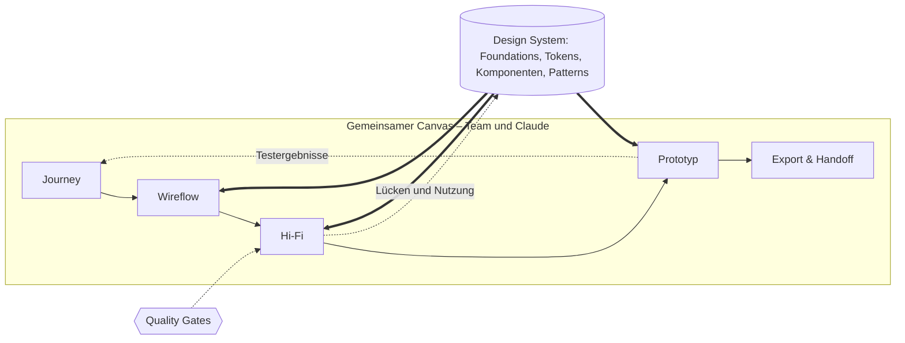
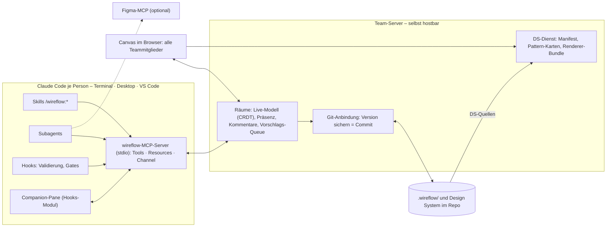
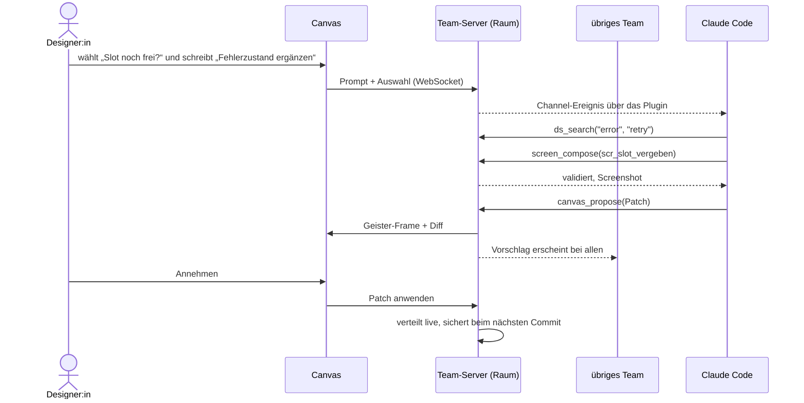
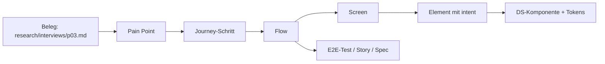
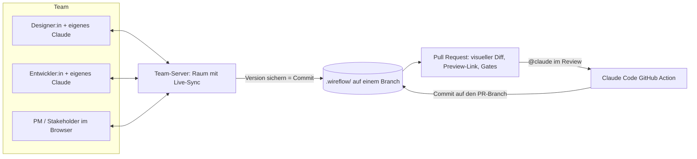

# Wireflow Studio

**Konzept für ein Claude-Code-Plugin: ein gemeinsamer Canvas, auf dem Teams mit ihrem Design System gestalten – von der User Journey bis zum klickbaren Prototyp.**

> Status: Konzeptentwurf v0.2 · Stand: 23.11.2026 · „Wireflow Studio“ ist ein Arbeitstitel
> Click-Dummy der Canvas-Oberfläche: [`prototype/index.html`](prototype/index.html) (im Browser öffnen)

---

## Inhalt

1. [Zusammenfassung](#1-zusammenfassung)
2. [Problem und Chance](#2-problem-und-chance)
3. [Vision und Designprinzipien](#3-vision-und-designprinzipien)
4. [Zielgruppen](#4-zielgruppen)
5. [Funktionsumfang](#5-funktionsumfang)
6. [Durchgängiges Beispiel](#6-durchgängiges-beispiel)
7. [UI-Konzept](#7-ui-konzept)
8. [Architektur](#8-architektur)
9. [Datenmodell](#9-datenmodell)
10. [Claude als Co-Designer](#10-claude-als-co-designer)
11. [Zusammenarbeit im Team](#11-zusammenarbeit-im-team)
12. [Sicherheit und Datenschutz](#12-sicherheit-und-datenschutz)
13. [Positionierung](#13-positionierung)
14. [MVP und Roadmap](#14-mvp-und-roadmap)
15. [Erfolgsmessung](#15-erfolgsmessung)
16. [Risiken](#16-risiken)
17. [Offene Entscheidungen](#17-offene-entscheidungen)
18. [Anhang: Befehle, Glossar, Quellen](#18-anhang)

---

## 1. Zusammenfassung

**Wireflow Studio** ist ein **gemeinsamer Canvas, auf dem Teams mit ihrem Design System gestalten** – von der User Journey über Wireflows und Hi-Fi-Screens bis zum klickbaren Prototyp. Zwei Ideen tragen das Konzept:

1. **Das Design System ist das Material.** Foundations, Tokens, Komponenten und vor allem Patterns werden zu einem kuratierten DS-Manifest. Alles auf dem Canvas besteht daraus: Wireflows folgen den Patterns, Hi-Fi-Screens bestehen aus echten Komponenten und Tokens, Abweichungen und Lücken werden sichtbar. Claude kennt dieses Manifest so gut wie das DS-Team.
2. **Ein Canvas für das ganze Team.** Design, Produkt, Entwicklung, Research und Stakeholder arbeiten live auf demselben Canvas – mit Präsenz, Kommentaren und Freigaben. Claude ist dabei Teammitglied: Jede Person kann mit ihrer eigenen Claude-Code-Sitzung mitarbeiten, und alle Vorschläge sind für alle sichtbar.

| Ebene | Was entsteht | Rolle des Design Systems |
|---|---|---|
| **User Journey** | Phasen, Schritte, Emotionskurve, Pain Points, Chancen – jede Aussage mit Beleg | Chancen werden mit passenden Patterns oder DS-Lücken verknüpft |
| **Wireflow** | Screens, Interaktionen, Entscheidungen, Zustände | Patterns bestimmen, welche Zustände und Pfade ein Flow braucht |
| **Hi-Fi-Design** | Screens aus echten Komponenten und Tokens | nur Komponenten, Props und Tokens aus dem Manifest; Lücken werden markiert |
| **Prototyp** | klickbarer Flow mit Variablen und Bedingungen | rendert mit den echten Komponenten – so, wie später gebaut wird |

Für das DS-Team wird der Canvas der Ort, an dem es sieht, wie das Design System genutzt wird, wo es Lücken hat und was als Nächstes gebaut werden sollte.

**Kernentscheidungen auf einen Blick**

| Thema | Entscheidung |
|---|---|
| Kerngedanke | Design System als Material: kuratiertes DS-Manifest aus Foundations, Tokens, Komponenten, Patterns sowie Content- und A11y-Regeln ([Vertiefung](design-system-integration.md)) |
| Produktform | gemeinsamer Canvas für das Team – live, mit Präsenz, Kommentaren und Freigaben; im Browser für alle, in Claude Code für alle, die mit Claude arbeiten |
| Architektur | Team-Server (selbst hostbar) mit Räumen, DS-Manifest und Renderer-Bundle; das Claude-Code-Plugin verbindet jede Claude-Sitzung mit dem Raum |
| Gedächtnis | Git: „Version sichern“ ist ein Commit; Reviews und Freigaben laufen über Pull Requests |
| Schnittstelle zu Claude | MCP-Server im Plugin (Tools, Resources, Channel) plus Skills, Subagents und Hooks |
| Design-Treue | Screens sind validierte Komponentenbäume (*Screen-IR*); Patterns steuern Komponentenwahl und Flow-Zustände |
| MVP-Fokus | ein React-Design-System (Vorschlag als Referenz: Primer), gemeinsamer Canvas mit Präsenz, Kommentaren und gemeinsamer Vorschlags-Queue |

---

## 2. Problem und Chance

Der typische Weg heute: Research → Journey Map (Whiteboard) → User Flows (Design-Tool) → Wireframes → Hi-Fi (Design-Tool) → Prototyp → Handoff → Code. Jeder Pfeil ist ein Medienbruch.

| Problem | Folge |
|---|---|
| **Getrennte Artefakte:** Journey, Flows und Screens liegen in verschiedenen Tools ohne Verknüpfung | Änderungen werden nicht nachgezogen; niemand weiß, welcher Screen welchen Pain Point löst |
| **Design-System-Drift:** Mocks nutzen abgelöste Komponenten oder freie Werte; Design-Bibliothek ≠ Code-Bibliothek | Die Entwicklung interpretiert nach – Inkonsistenz und Mehrarbeit |
| **Patterns werden nicht gefunden:** Jedes Team löst dieselbe Situation (Fehler, Leerzustand, Speichern) anders | Uneinheitliches Produkt, Doppelarbeit |
| **DS-Teams arbeiten blind:** Sie sehen nicht, wo und wie das Design System genutzt wird und was fehlt | Roadmap nach Bauchgefühl, Lücken werden lokal gestopft |
| **Abstimmung in getrennten Tools:** Design, Produkt, Entwicklung und Research arbeiten in verschiedenen Werkzeugen und Meetings | Entscheidungen gehen verloren, Rückfragen im Handoff |
| **Generische KI-Entwürfe:** Prompt-to-UI-Werkzeuge kennen das eigene Design System nicht | Ergebnisse wirken gut, sind aber nicht übernehmbar |
| **Nur der Happy Path:** Leer-, Lade- und Fehlerzustände fehlen | Sie entstehen erst in der Entwicklung – ungestaltet |
| **Handoff als Abschrift:** Specs, Akzeptanzkriterien und Testfälle werden manuell abgeleitet | Zeitverlust und Lücken |

**Die Chance:** Ein Design System ist das gemeinsame Vokabular eines Produktteams – aber es lebt in Doku, Paketen und Bibliotheken, nicht dort, wo das Team gemeinsam gestaltet und entscheidet. Claude Code arbeitet bereits im Repository, wo das echte Design System liegt, und kann es lesen, anwenden und prüfen. Es fehlen drei Dinge:

1. ein **strukturiertes Modell des Design Systems**, das Patterns einschließt – damit Menschen und Claude dieselben Regeln anwenden,
2. ein **gemeinsamer Canvas**, auf dem das ganze Team live mit diesem Material arbeitet, mit Claude als Teammitglied, und
3. ein **durchgängiges Modell** für Journey → Flow → Screen → Prototyp.

Das Plugin liefert alle drei.

---

## 3. Vision und Designprinzipien

> **Vision:** Teams gestalten gemeinsam auf einem Canvas – mit ihrem Design System als Material und Claude als Teammitglied, das dieses Design System so gut kennt wie sie. Was dort entsteht, ist konsistent, testbar und ohne Übersetzung umsetzbar.

1. **Das Design System ist das Material.** Menschen und Claude komponieren aus Komponenten, Tokens und Patterns des DS. Was fehlt, wird als *DS-Lücke* markiert – nicht erfunden – und kann als Beitrag ans DS-Team gehen.
2. **Ein Canvas für das ganze Team.** Alle Rollen arbeiten live am selben Stand; wer kein Claude Code nutzt, ist im Browser dabei. Kommentare und Freigaben hängen direkt an den Elementen.
3. **Claude ist Teammitglied, Menschen entscheiden.** Vorschläge sind für alle sichtbar, begründet und lassen sich annehmen, verwerfen, variieren und rückgängig machen.
4. **Ein Modell, viele Sichten.** Journey, Wireflow, Design und Prototyp sind Ansichten desselben verknüpften Graphen. Nichts wird kopiert.
5. **Progressive Fidelity.** Lo-Fi, Mid-Fi und Hi-Fi sind Stufen derselben Knoten. Die Absicht eines Elements (`intent`, z. B. „primäre Aktion“) bleibt erhalten, wenn sich die Darstellung ändert.
6. **Strukturiert statt Pixelschieben.** Auto-Layout und Komponenteninstanzen statt freier Vektoren – alles Gestaltete ist baubar.
7. **Git als Gedächtnis.** Der Raum ist der Live-Stand, Git die Versionsgeschichte: Klartext-Dateien mit stabilen IDs, lesbare Diffs, Review per Pull Request.
8. **Offen.** Standards und Brücken statt Insel: MCP, DTCG-Tokens, Storybook, Figma, Mermaid.

---

## 4. Zielgruppen

| Rolle | Job-to-be-done | Nutzen |
|---|---|---|
| Design-System-Team | „Wissen, wie das DS genutzt wird, was fehlt und was als Nächstes kommt.“ | DS-Insights, Lücken- und Pattern-Report, Beiträge direkt aus dem Canvas |
| UX-/Product-Designer:in | „Schnell von Research zu einem testbaren Prototyp – ohne DS-Regeln zu brechen.“ | Claude übernimmt Fleißarbeit (Zustände, Varianten, Content); Fokus auf Entscheidungen |
| Design Engineer / Frontend | „Designs, die 1:1 aus unseren Komponenten bestehen.“ | Screen-IR wird ohne Übersetzung zu Code; Flows werden zu E2E-Tests |
| Product Manager:in | „Scope schneiden, Lücken früh sehen, mitentscheiden.“ | live im Canvas dabei, Abdeckung Journey ↔ Screens, Freigaben |
| UX Researcher:in | „Erkenntnisse sollen im Design ankommen.“ | Belegte Pain Points, verfolgbar bis in einzelne Screens |
| Stakeholder | „Den Stand sehen und Feedback geben, ohne etwas zu installieren.“ | Browser-Zugang, Kommentare, Prototyp testen |

---

## 5. Funktionsumfang

Zwei Module tragen alle anderen: das **Design System als Fundament** (5.3) und der **gemeinsame Canvas** (5.5). Journey, Wireflow, Hi-Fi und Prototyp sind die Tätigkeiten, die das Team darauf ausführt.



### 5.1 Journey Mapper

- **Eingaben:** Interviewnotizen, Research-Synthesen, Personas, PRDs, Support-Tickets, Analytics-Exporte – als Dateien im Repo oder direkt im Chat.
- **Struktur** nach gängiger Journey-Mapping-Praxis: Persona, Szenario und Erwartungen, Phasen, Schritte mit Aktionen, Touchpoints und Kanäle, Gedanken, Emotionskurve, Pain Points, Chancen; optional Backstage-Lanes wie in einem Service Blueprint.
- **Evidenzpflicht:** Jeder Pain Point verweist auf seine Quellen (Datei und Zeilen). Unbelegte Aussagen kennzeichnet Claude als *Hypothese*.
- **Ist und Soll:** Ist-Journey aus Research, Soll-Journey als Gestaltungsziel, Vergleichsansicht.
- **Brücke zum Design System:** Chancen werden mit passenden Patterns verknüpft – oder als Pattern-Lücke markiert, wenn das DS noch keine Lösung kennt.
- **Brücke zum Produkt:** Schritte mit Produktbezug werden zu Ankern für Wireflows. Die Abdeckung ist sichtbar („3 von 4 Schritten haben Screens“).

### 5.2 Wireflow Editor

- **Elemente:** Screen (Frame), Verbindung (Trigger → Ziel, optional mit Bedingung), Entscheidung, Systemschritt (API-Aufruf, E-Mail, Push), Ein- und Ausstieg, Sub-Flow, Notiz.
- **Zustände als Varianten:** Standard, Laden, Leer, Fehler, Erfolg, Teildaten. Claude schlägt fehlende Zustände vor.
- **Erzeugung** aus Journey-Schritten, aus Text („Gastbestellung mit Zahlung per Rechnung“) oder **aus bestehendem Code**: Router und Navigationsaufrufe ergeben einen Ist-Flow – wertvoll bei Redesigns.
- **Auto-Layout** des Graphen (geschichtet, z. B. mit ELK), Lanes für Akteure oder Geräte.
- **Pattern-gesteuert:** Erkennt Claude im Flow eine Situation mit Pattern (Speichern, Formular, Liste, Benachrichtigung), ergänzt es die Zustände und Pfade, die das Pattern verlangt – als Vorschlag.
- **Integritäts-Checks:** Sackgassen, unerreichbare Screens, Entscheidungen ohne Nein-Pfad, fehlender Zurück-Weg, nicht abgedeckte Journey-Schritte.
- **Notation** wie bei klassischen Wireflows: Pfeile starten am auslösenden Element (Hotspot), nicht am Rand des Screens.

### 5.3 Design System als Fundament

Das Design System ist das Material, aus dem alles auf dem Canvas besteht. Das Plugin liest seine Quellen und normalisiert sie in ein **DS-Manifest** – die gemeinsame Sprache von Team und Claude. Welche Informationen nötig sind und wie die Anbindung abläuft, beschreibt die [Vertiefung zur Design-System-Integration](design-system-integration.md) am Beispiel von Primer.

| Schicht | Inhalt | Quellen (Beispiele) |
|---|---|---|
| Foundations | Farbrollen, Typografie, Layout, Icons, Barrierefreiheit | Doku-Website, MDX |
| Design Tokens | Basis- und semantische Tokens, Modi (Light, Dark, Marke) | DTCG 2025.10 inkl. Resolver, Style Dictionary, Tailwind-Theme, CSS-Variablen, Figma-Variablen |
| Komponenten | Props, Varianten, Unterkomponenten, Zustände, Reifegrad, A11y-Vertrag | TypeScript-Analyse, Storybook-Manifest, Code Connect |
| **Patterns** | Auslöser, Entscheidungsregeln, verlangte Zustände und Pfade, Content-Vorlagen | Doku, MCP-Server des Design Systems (z. B. `@primer/mcp`), produkteigene Muster |
| Content & A11y | Tonalität, Terminologie, Microcopy, WCAG-Zielniveau | Richtlinien im Repo oder in der Doku |

- **Patterns sind die Brücke:** Intent im Wireflow → passendes Pattern → Komponenten im Hi-Fi. Patterns legen außerdem fest, welche Zustände und Pfade ein Flow braucht – etwa den Fehlerpfad beim Speichern oder den Leerzustand einer Liste.
- **Kuratierbar:** Das Manifest ist eine lesbare Datei; Pattern-Karten liegen als Markdown mit YAML-Kopf daneben. Das DS-Team prüft Änderungen per Pull Request.
- **Aktuell:** Ein Hook markiert das Manifest als veraltet, sobald sich DS-Quellen ändern. Neue DS-Versionen erscheinen an betroffenen Screens als „DS-Update verfügbar“, inklusive Migrationshinweisen.
- **DS-Insights für das DS-Team:** Welche Komponenten und Patterns werden wo genutzt, wo wird abgewichen, welche Lücken tauchen in mehreren Flows auf? Daraus entsteht eine belegte Roadmap für das Design System.
- **Vom Gap zum DS-Beitrag:** Eine DS-Lücke lässt sich direkt als Beitrag anstoßen. Claude entwirft Spezifikation, Beispiel-Story und Pattern-Karte als Pull Request ans DS-Repo; das DS-Team entscheidet.

### 5.4 Hi-Fi Generator

Pipeline pro Screen:

1. **Planen:** Zweck und Inhaltshierarchie bestimmen, dann das passende Pattern wählen und seine Entscheidungsregeln anwenden (Suche im Manifest).
2. **Komponieren:** Screen-IR erzeugen – einen Komponentenbaum mit Props, Slots und Tokens.
3. **Validieren:** Der Server prüft gegen das Manifest. Unbekannte Komponente, Prop oder Token = Fehler mit Korrekturhinweis.
4. **Rendern:** echte Komponenten im Renderer, Screenshot per Playwright.
5. **Selbstkritik:** Claude sieht Screenshot und Lint-Ergebnisse (DS, A11y) und korrigiert – höchstens zwei bis drei Runden, budgetiert.
6. **Vorschlagen:** als Geister-Frame auf dem Canvas, mit Begründung; auf Wunsch zwei bis drei Varianten nebeneinander.

Dazu kommen:

- **Realistischer Content** nach den Content-Richtlinien statt Lorem ipsum. Deutsche Texte sind länger als englische – ein guter Robustheitstest.
- **Responsive Layouts** über Breakpoints aus dem Manifest.
- **Themes und Modi** über den Token-Resolver (Light, Dark, Marken).
- **Umgang mit Lücken:** Passt keine Komponente, komponiert Claude aus Primitiven und markiert die Stelle als DS-Lücke.

### 5.5 Gemeinsamer Canvas (Figma-ähnlich)

Der Canvas ist der gemeinsame Arbeitsort des Teams. Alle sehen live denselben Stand – Menschen im Browser oder über Claude Code, Claude-Sitzungen als Teilnehmende.

- **Team live:** Avatare, Live-Cursor, Auswahl in Personenfarben, „Folgen“-Modus, Soft-Locks („Lisa bearbeitet …“), Kommentar-Pins mit Erwähnungen und eine gemeinsame Vorschlags-Queue für alle Claude-Vorschläge. Details in [Kapitel 11](#11-zusammenarbeit-im-team).
- Unendlicher Canvas mit Zoom und Pan, Frames, Sections, Verbindungen, Kommentaren und Minimap.
- **Links:** Ebenen (Flow → Screens → Komponentenbaum), Komponenten (aus dem DS-Manifest, per Drag & Drop), Tokens.
- **Rechts – Inspector** mit vier Tabs:
  - *Design:* Komponente, Variante, Props. Werte nur aus Tokens; freie Werte werden markiert.
  - *Prototyp:* Interaktionen (Trigger, Aktion, Ziel, Animation, Bedingung).
  - *Code:* JSX-Ausschnitt mit Imports.
  - *Qualität:* DS- und Pattern-Konformität, A11y, Heuristiken, Flow-Integrität.
- **Oben:** Modus-Umschalter **Journey · Wireflow · Design · Prototyp**, Werkzeuge, Zoom, Claude-Status, Teilen und Export.
- **Unten:** die Claude-Leiste (⌘K), die die aktuelle Auswahl kennt.
- **Bearbeitung im Frame ist strukturell:** Auto-Layout-Stacks, Umsortieren per Drag im Canvas oder im Ebenenbaum, Props im Inspector. Freie Platzierung gibt es nur auf einer Skizzen-Ebene im Lo-Fi.

Details in [Kapitel 7](#7-ui-konzept).

### 5.6 Prototyping

- **Interaktionen** stammen direkt aus den Wireflow-Verbindungen: Trigger (Tippen, Absenden, Hover, Wischen, Taste, Timer, Systemereignis) → Aktion (Navigieren, Overlay öffnen oder schließen, Zurück, Variable setzen, Scrollen) mit Animation (Sofort, Überblenden, Schieben, Push).
- **Variablen und Bedingungen** (z. B. `angemeldet`, `slotFrei`) machen Verzweigungen spielbar, ohne eine echte App zu bauen.
- **Echte Komponenten** bedeuten: Eingabefelder, Fokus und Validierungszustände verhalten sich realistisch.
- **Präsentationsmodus** mit Geräterahmen und Hotspot-Hinweisen; **statischer Export** als teilbarer Link.
- **Testmodus:** Aufgaben aus der Journey („Buche einen Termin für nächste Woche“), Pfadaufzeichnung, Vergleich mit dem erwarteten Pfad, Zeit pro Aufgabe. Die Ergebnisse fließen als Belege in die Journey zurück.

### 5.7 Quality Gates

| Gate | Prüft | Wie |
|---|---|---|
| DS-Konformität | Anteil DS-Komponenten und Tokens, Abweichungen | Abgleich Screen-IR ↔ Manifest (deterministisch) |
| Pattern-Konformität | Situationen ohne oder mit abweichendem Pattern | Abgleich mit den Pattern-Karten; Lint-Regeln aus `regeln` und `entscheidung` |
| Barrierefreiheit | WCAG 2.2 AA: Kontrast, Zielgrößen, Fokusreihenfolge, Labels, Überschriften | axe-core auf gerenderten Screens plus Review durch Subagent |
| Flow-Integrität | Sackgassen, Waisen, fehlende Zustände und Pfade | Graph-Analyse (deterministisch) |
| Heuristiken | Nielsens zehn Heuristiken, Konsistenz der Muster | Subagent `ux-critic` mit frischem Kontext |
| Content | Tonalität, Terminologie, Textlängen | Content-Richtlinien aus dem Manifest |
| Walkthrough | kognitiver Walkthrough aus Sicht der Persona | Subagent spielt den Prototyp anhand von Screenshots durch – ersetzt keine Tests mit echten Menschen |

Ergebnisse erscheinen als Marker auf dem Canvas, im Qualität-Tab und als Zusammenfassung im Chat. Gates können Exporte blockieren (konfigurierbar).

### 5.8 Export und Handoff

- **Code:** Routen- und Seitengerüste mit DS-Komponenten (React zuerst), Storybook-Stories pro Screen-Zustand, **Playwright-Testgerüste aus Flows** (jeder Pfad ein Testfall), Tracking-Plan aus den Interaktionen.
- **Design:** Frames nach Figma mit echten Bibliotheksinstanzen (über den Figma-MCP-Server, wo Code Connect zuordnet); die Journey als FigJam-Diagramm.
- **Dokumentation:** Markdown-Spec pro Flow (Screens, Zustände, Interaktionen, Akzeptanzkriterien in Gherkin), Mermaid-Flowchart, PNG und PDF.
- **Tickets:** pro Screen oder DS-Lücke über vorhandene Connectoren (z. B. Linear, Jira) – optional.

---

## 6. Durchgängiges Beispiel

**„Acme Health – Arzttermin online buchen“** (fiktiv; derselbe Fall steckt im Click-Dummy)

```text
> /wireflow:init
  ✓ Design System erkannt: @acme/ui (React) · 48 Komponenten · 212 Tokens (DTCG) · 14 Patterns · Storybook :6006
  ✓ Team-Server verbunden · Raum „Termin buchen“ · 3 Personen online
  ✓ .wireflow/ angelegt · Renderer konfiguriert · 3 DS-Lücken gefunden

> /wireflow:journey research/interviews/*.md --persona berufstaetig
  ✓ Journey „Arzttermin buchen (Ist)“ · 5 Phasen · 9 Pain Points, alle mit Belegen
  ↳ Tiefpunkt: „Slot beim Absenden vergeben, Eingaben weg“ (P03, P07, P11)

> Leite daraus den Soll-Flow für die Buchung ab, inklusive Neupatient:innen.
  ✓ Flow „Termin buchen“ · 6 Screens · 2 Entscheidungen · 8 Verbindungen
  ⚠ Integrität: Entscheidung „Slot noch frei?“ hat keinen Nein-Pfad

> /wireflow:hifi --variants 2
  ✓ 6 Screens · DS-Konformität 97 % · 2 Lücken (Zeit-Slot-Auswahl aus ChipGroup, Erfolgs-Illustration)
  ↳ 2 Varianten für „Ergebnisse“ liegen als Vorschlag auf dem Canvas

> /wireflow:review a11y,flow
  ✓ 0 kritische A11y-Befunde · 1 Befund: Metatext-Kontrast 3,6:1 → Token-Fix vorgeschlagen

> /wireflow:export react,stories,e2e
  ✓ 7 Routen-Gerüste · 14 Stories · 4 Playwright-Tests auf Branch feature/terminbuchung
```

Zwischen den Schritten arbeitet das Team live im selben Raum: Design und Entwicklung wählen Variante A und korrigieren einen Abstand über ein Token. Die Produktverantwortliche kommentiert im Browser „@claude Fehlerzustand für vergebene Slots ergänzen“ – Claudes Vorschlag folgt dem Pattern für Fehlermeldungen, erscheint bei allen und wird angenommen.

---

## 7. UI-Konzept

Der [Click-Dummy](prototype/index.html) zeigt die Oberfläche interaktiv: Modi wechseln (Tasten `1`–`4`), Screens und Elemente auswählen, Frames verschieben, zoomen (Strg/⌘ + Mausrad), den Prototyp mit Variablen durchklicken, einen Claude-Vorschlag annehmen und den Flow als Mermaid exportieren. Claudes Antworten sind dort simuliert; alle Daten sind fiktiv.

### 7.1 Aufbau

```text
┌───────────────────────────────────────────────────────────────────────────┐
│ [Journey|Wireflow|Design|Prototyp] · ◕ Lisa ◕ Tom ✦ Claude · Teilen       │
├──────────────┬──────────────────────────────────────────────┬─────────────┤
│ Ebenen       │        ◣ Lisa                    ◣ Claude    │ Inspector   │
│ Komponenten  │  [Suche]──▶[Ergebnisse]──▶[Profil]──▶◇──▶…   │  Design     │
│ Patterns     │                                      │       │  Prototyp   │
│ Tokens       │                                 [Anmelden]   │  Code       │
│ Baum der     │  ┄┄ Vorschlag von Claude ┄┄   ◣ Tom          │  Qualität   │
│ Auswahl      │          ◉ 2 Kommentare                      │  Kommentare │
├──────────────┴──────────────────────────────────────────────┴─────────────┤
│ ✦ Claude fragen … (⌘K) · Auswahl: „Profil & Termine“ · Vorschläge (3)     │
└───────────────────────────────────────────────────────────────────────────┘
```

### 7.2 Modi

| Modus | Zeigt | Werkzeuge | Typische Claude-Aktionen |
|---|---|---|---|
| **Journey** | Phasen × Lanes, Emotionskurve, Pain Points mit Belegen | Karte, Lane, Verknüpfen | „Synthetisiere die Interviews“, „Finde Chancen“, „Leite einen Flow ab“ |
| **Wireflow** | Lo-Fi-Screens, Verbindungen, Entscheidungen | Screen, Verbindung, Entscheidung, Notiz | „Ergänze Fehlerzustände“, „Prüfe auf Sackgassen“, „Ordne neu an“ |
| **Design** | dieselben Screens in Hi-Fi mit echten DS-Komponenten | Komponente einfügen, Auto-Layout, Tokens | „Erzeuge Hi-Fi“, „Variante B“, „Prüfe den Dark Mode“ |
| **Prototyp** | Gerät mit klickbarem Flow, Variablen | Abspielen, Hotspots, Testaufgabe | „Spiele den Walkthrough als Persona“, „Erstelle Testaufgaben“ |

Wireflow und Design teilen Layout und Positionen: Der Wechsel ist ein Fidelity-Wechsel, kein Dateiwechsel.

### 7.3 Interaktionsmuster mit Claude

- **Claude-Leiste (⌘K)** mit Auswahl-Kontext („2 Screens ausgewählt“) und passenden Vorschlägen.
- **Vorschläge als Geister-Elemente:** gestrichelt in Claude-Violett, mit *Annehmen · Verwerfen · Variante*. Geänderte Elemente tragen ein Diff-Badge.
- **Begründung auf Nachfrage:** „Warum?“ zeigt die Herleitung – Manifest-Eintrag, Research-Zitat, Heuristik.
- **Kommentare an Claude:** `@claude` in einem Kommentar wird zur Aufgabe in der laufenden Sitzung.
- **Präsenz:** Avatare und Live-Cursor aller Teammitglieder; jede aktive Claude-Sitzung hat einen eigenen Cursor („Claude für Lisa bearbeitet ‚Angaben prüfen‘ …“).
- **Gemeinsamer Verlauf:** Änderungen von Menschen und Claude liegen in einer Undo-Historie, filterbar nach Autor.

### 7.4 Companion-UI in Claude Code

Neben dem Browser-Canvas bekommt die Claude-Code-Sitzung selbst eine schlanke Oberfläche über die UI-API der Plugin-Hooks-Module (Early Access, siehe [8.3](#83-plugin-bausteine)):

- **Pane „Wireflow“** neben dem Chat (Terminal im Vollbild, Desktop-App, VS Code): Flow-Übersicht als Minimap (SVG; im Terminal als Textbaum), aktuelle Canvas-Auswahl, Qualitätsstatus, Buttons „Canvas öffnen“ und „Vorschlag annehmen“.
- **Vorschau unter Tool-Aufrufen:** Komponiert Claude einen Screen, zeigt die Zeile im Verlauf eine Miniatur und den DS-Score.
- **Statuszeile:** `Termin buchen · 7 Screens · DS 97 % · 1 Warnung`.
- **Desktop-App:** Der vollständige Canvas läuft im integrierten Browser-Bereich neben dem Chat.

### 7.5 Visuelle Sprache und Barrierefreiheit des Tools

- Neutrales Chrome (Grautöne, Light und Dark), eine Akzentfarbe für Auswahl und **eine eigene Farbe für alles, was Claude tut** – KI-Änderungen sind immer erkennbar.
- Vollständig per Tastatur bedienbar: `V` Auswahl, `H` Hand, `F` Screen, `C` Verbindung, `D` Entscheidung, `T` Text, `⌘K` Claude, `⇧1` alles zeigen, `1`–`4` Modi.
- **Outline-Ansicht** als barrierefreie Alternative zum Canvas: Journey und Flows als navigierbarer Baum für Screenreader.
- Reduzierte Bewegung wird respektiert; Kontraste des Chromes nach WCAG 2.2 AA.

---

## 8. Architektur

### 8.1 Überblick



### 8.2 Laufzeit

- **Team-Server (zentral, selbst hostbar):** hält die Räume – einen pro Flow und Branch – als CRDT-Dokumente, verteilt Änderungen an alle Teilnehmenden, speichert Kommentare und die Vorschlags-Queue und sichert Versionen als Commits ins Repo. Angemeldet wird über GitHub oder SSO; die Rechte am Repo gelten auch im Raum.
- **DS-Dienst im Team-Server:** hält das freigegebene DS-Manifest mit Pattern-Karten und baut daraus pro DS-Version ein **Renderer-Bundle** – die echten Komponenten samt Providern als statisches Paket. Jeder Canvas lädt es in Sandbox-iframes. So sehen alle dieselben Hi-Fi-Screens, ohne lokales Setup.
- **Plugin in Claude Code (pro Person):** Claude Code startet den wireflow-MCP-Server (stdio). Er verbindet die Claude-Sitzung mit dem Raum: Claude liest Auswahl und Modell und schreibt Patches und Vorschläge. Für unveröffentlichte DS-Änderungen startet er bei Bedarf lokal einen Vite-Renderer (DS-Branch-Vorschau), konfiguriert in `wireflow.config.ts`.
- **Canvas im Browser** für alle Teammitglieder, auch ohne Claude Code; in der Desktop-App auch im Browser-Bereich neben dem Chat.
- **Screenshots** per Playwright (headless): im Team-Server für Thumbnails, Diffs und Exporte, lokal für Claudes Selbstkritik.
- **Einzelmodus:** Ohne Team-Server hostet der MCP-Server den Canvas selbst auf `127.0.0.1` – für Spikes oder Arbeit offline.

### 8.3 Plugin-Bausteine

```text
wireflow/
├── .claude-plugin/plugin.json      Manifest inkl. userConfig
├── skills/
│   ├── init/SKILL.md               /wireflow:init
│   ├── ds/SKILL.md                 /wireflow:ds
│   ├── journey/SKILL.md            /wireflow:journey
│   ├── flow/SKILL.md               /wireflow:flow
│   ├── hifi/SKILL.md               /wireflow:hifi
│   ├── canvas/SKILL.md             /wireflow:canvas
│   ├── prototype/SKILL.md          /wireflow:prototype
│   ├── review/SKILL.md             /wireflow:review
│   ├── export/SKILL.md             /wireflow:export
│   └── ux-methods/                 Methodenwissen (nur von Claude geladen)
│       ├── SKILL.md
│       └── references/             journey-mapping.md, wireflow-notation.md,
│                                   heuristics.md, wcag22-checklist.md, screen-ir.md
├── agents/                         journey-analyst, flow-architect, ds-curator,
│                                   ui-composer, ux-critic
├── hooks/
│   ├── hooks.json                  klassische Hooks + Verweis auf das Hooks-Modul
│   └── register.tsx                Companion-Pane, Tool-Vorschau, Statuszeile
├── .mcp.json                       wireflow-Server (stdio)
├── bin/wireflow                    CLI: validate, lint, render, export, doctor
├── server/                         MCP-Server, Core, Canvas-Backend (TypeScript)
├── canvas/                         Canvas-Web-App (React)
└── schemas/                        JSON-Schemas: journey, flow, screen, ds-manifest
```

| Baustein | Aufgabe im Plugin |
|---|---|
| **Skills** | Arbeitsanweisungen und Methodenwissen, per Slash-Command aufrufbar (`/wireflow:hifi`). Progressive Disclosure: Details liegen in `references/` und werden nur bei Bedarf geladen. |
| **Subagents** | spezialisierte Rollen mit eigenem Kontext, parallelisierbar (siehe [Kapitel 10](#10-claude-als-co-designer)) |
| **MCP-Server** | „die Hände“: deterministische Operationen auf Modell, Canvas, Renderer und Exporten; verbindet die Sitzung mit dem Raum auf dem Team-Server |
| **Channel** | schiebt Prompts aus der Canvas-Leiste und `@claude`-Kommentare in die laufende Sitzung (Channels sind eine Research Preview und müssen aktiviert werden) |
| **Hooks** | Leitplanken und Automatik (Tabelle unten) |
| **Hooks-Modul** | Companion-UI: Pane, Vorschau unter Tool-Zeilen, Statuszeile, Kontextmenü der Desktop-App. Die API ist Early Access und kann sich ändern – deshalb optional; der Kern läuft über MCP und Browser. |
| **`bin/`** | Die CLI liegt während der Plugin-Nutzung im `PATH` des Bash-Tools und läuft unverändert in CI. |
| **`userConfig`** | fragt beim Aktivieren DS-Paket, Token-Pfade, Framework, Storybook-URL und Port ab |

**Hooks**

| Ereignis | Auslöser | Aktion |
|---|---|---|
| `SessionStart` | Sitzungsbeginn | `wireflow doctor --brief`: Projektstatus und veraltetes Manifest als Kontext für Claude |
| `PostToolUse` | `Write`/`Edit`; das Skript filtert auf `.wireflow/**` | Schema-Validierung und Integritäts-Lint; Fehler gehen als Rückmeldung an Claude |
| `PostToolUse` | `Write`/`Edit` auf DS-Quellen | Manifest als veraltet markieren |
| `Stop` | Antwort fertig | Hinweis auf offene Vorschläge oder nicht bestandene Gates |

**Manifest (Auszug)**

```json
{
  "name": "wireflow",
  "displayName": "Wireflow Studio",
  "version": "0.1.0",
  "description": "Journeys, Wireflows und Hi-Fi-Prototypen aus dem eigenen Design System",
  "keywords": ["ux", "wireflow", "journey-map", "design-system", "prototyping"],
  "userConfig": {
    "designSystem": { "type": "string", "title": "Design-System-Paket", "description": "z. B. @acme/ui", "required": true },
    "framework": { "type": "string", "title": "Renderer", "description": "Framework der DS-Komponenten", "options": ["react", "vue", "web-components"], "default": "react" },
    "storybookUrl": { "type": "string", "title": "Storybook-URL", "description": "optional, z. B. http://localhost:6006" },
    "canvasPort": { "type": "number", "title": "Canvas-Port", "description": "lokaler Port der Canvas-App", "default": 4400 }
  }
}
```

### 8.4 MCP-Schnittstelle

| Bereich | Tool | Zweck |
|---|---|---|
| Raum | `room_join` | Raum auf dem Team-Server betreten; die Claude-Sitzung erscheint mit eigenem Cursor |
| Projekt | `project_status` | Journeys, Flows, Screens, offene Vorschläge, Qualitätsstatus |
| Canvas | `canvas_open` | Canvas starten oder fokussieren, URL zurückgeben |
| | `canvas_selection` | aktuelle Auswahl und Ausschnitt, optional mit Screenshot |
| | `canvas_propose` | Änderungen als Vorschlag auf der Geister-Ebene zeigen |
| Journey | `journey_upsert` | Journey, Phasen, Schritte anlegen oder ändern |
| | `journey_link` | Schritte mit Flows und Screens verknüpfen |
| Flow | `flow_upsert` | Knoten und Kanten anlegen oder ändern |
| | `flow_validate` | Integritäts-Check |
| | `flow_layout` | Auto-Layout |
| | `flow_from_code` | Ist-Flow aus Routen und Navigation ableiten |
| Design System | `ds_sync` | Quellen indizieren, Manifest aktualisieren |
| | `ds_search` | Komponenten, Muster, Tokens nach Intent oder Stichwort |
| | `ds_component` | Props-Schema, Varianten, Richtlinien, Beispiele |
| | `ds_gaps` | Lücken-Report |
| Screen | `screen_compose` | Screen-IR validieren und speichern |
| | `screen_render` | rendern, Screenshot als Bild zurückgeben |
| | `screen_lint` | DS- und A11y-Lint |
| Prototyp | `prototype_build` | Interaktionen und Variablen kompilieren, Link erzeugen |
| | `prototype_results` | Testpfade und Kennzahlen |
| Export | `export` | Ziele: `react`, `stories`, `e2e`, `figma`, `spec`, `mermaid`, `png` |

**Resources:** `wireflow://project`, `wireflow://flows/{id}`, `wireflow://screens/{id}`, `wireflow://canvas/selection`, `ds://manifest`, `ds://components/{id}`.

**Schreibprinzip:** Alle Änderungen laufen als Patch-Operationen mit Autor (`user` oder `claude`) und Status (`proposed` oder `applied`). Das ergibt Undo, Vorschläge und einen Audit-Trail aus einem Mechanismus.

### 8.5 Synchronisation: Raum, Claude und Git

- **Claude → Raum:** Tool-Aufruf → Patch mit Basisversion → Team-Server → alle Canvas-Instanzen aktualisieren sich live. Vorschläge landen in der gemeinsamen Vorschlags-Queue und auf der Geister-Ebene.
- **Canvas → Claude:** Auswahl und Ausschnitt einer Person stehen ihrer Claude-Sitzung als MCP-Resource bereit. Prompts aus der Claude-Leiste und `@claude`-Kommentare gelangen als Channel-Ereignis in die Sitzung dieser Person. Fallback ohne Channels: eine Inbox, die das Companion-Pane anzeigt und als nächsten Prompt einreiht.
- **Raum ↔ Git:** „Version sichern“ schreibt den Raumstand als Commit, mit allen Beteiligten als Co-Autor:innen. Branch-Wechsel und Merges im Repo lädt der Team-Server in den Raum. Weil jede Entität eine eigene Datei ist, bleiben Diffs und Konflikte klein.
- **Konflikte:** Gleichzeitige Live-Änderungen löst das CRDT auf. Claude-Sitzungen respektieren Soft-Locks und legen bei Konflikten Vorschläge an, statt direkt zu ändern. Details in [Kapitel 11](#11-zusammenarbeit-im-team).



### 8.6 Canvas-Technik

| Option | Stärken | Schwächen |
|---|---|---|
| **React Flow / xyflow** (MIT) | ausgereift für Knoten-Graphen; Knoten sind DOM, also echte Komponenten; Zoom, Minimap | wenig für freie Gestaltung; Board-Funktionen selbst bauen |
| **tldraw SDK** | sehr gute Infinite-Canvas-UX, Multiplayer | seit SDK 4.0 Lizenzschlüssel in Produktion; kommerzielle Nutzung kostenpflichtig |
| **Eigenentwicklung** (DOM + CSS-Transforms, ELK-Layout) | volle Kontrolle, keine Lizenzkosten | Aufwand für Auswahl, Snapping, Performance |

**Empfehlung:** MVP mit xyflow für Board und Graph, dazu ein eigener Frame-Editor für den Inhalt eines Screens (Komponentenbaum, Auto-Layout, Props). tldraw erst prüfen, wenn Whiteboard-Funktionen wichtig werden. Den Live-Sync übernimmt ein CRDT (z. B. Yjs) unter dem Modell – unabhängig von der Canvas-Bibliothek.

**Performance:** Level of Detail. Bei kleinem Zoom zeigen Frames gecachte Screenshots statt Live-iframes; nur sichtbare Frames werden live gerendert.

### 8.7 Konfiguration

```ts
// wireflow.config.ts – Paketnamen sind Platzhalter
import { defineConfig } from '@wireflow/config';

export default defineConfig({
  designSystem: {
    framework: 'react',
    package: '@acme/ui',
    tokens: ['tokens/**/*.tokens.json'], // DTCG 2025.10
    resolver: 'tokens/acme.resolver.json', // Light, Dark, Marken
    storybook: 'http://localhost:6006',
    figma: { fileKey: '<figma-file-key>' }, // optional, über den Figma-MCP-Server
  },
  renderer: {
    wrapper: './.wireflow/renderer/Providers.tsx', // Theme, i18n, Router-Mock
    viewports: { mobile: [390, 844], desktop: [1440, 900] },
  },
  gates: { dsCompliance: 0.95, a11y: 'wcag22-aa', blockExportOnFail: true },
});
```

---

## 9. Datenmodell

### 9.1 Ablage im Repo

```text
.wireflow/
├── project.json                      Name, Personas, Einstellungen
├── ds/manifest.json                  normalisiertes Design System
├── ds/patterns/*.md                  Pattern-Karten (Markdown mit YAML-Kopf)
├── decisions/*.md                    Entscheidungs-Log des Teams
├── comments/*.json                   Kommentar-Threads, verankert an IDs
├── journeys/termin-buchen.journey.json
├── flows/buchung.flow.json
├── screens/profil.screen.json        eine Datei pro Screen
├── prototypes/buchung.proto.json     Variablen, Startpunkte, Testaufgaben
└── reviews/2026-11-23-a11y.json      Ergebnisse der Quality Gates
```

### 9.2 Verknüpfungen



Jede Kante ist eine ID-Referenz. Daraus ergeben sich Abfragen wie „Welche Screens adressieren diesen Pain Point?“ oder „Welche Journey-Schritte verlieren Abdeckung, wenn dieser Screen entfällt?“.

### 9.3 Beispiele

**Journey (Auszug)**

```json
{
  "schema": "wireflow/journey@1",
  "id": "jrn_termin",
  "title": "Arzttermin online buchen",
  "variant": "soll",
  "persona": "per_berufstaetig",
  "scenario": "Hautausschlag seit einer Woche, Termin noch diese Woche gewünscht",
  "phases": [
    {
      "id": "ph_buchen",
      "title": "Termin buchen",
      "steps": [
        {
          "id": "stp_slot",
          "action": "Freien Termin wählen",
          "touchpoint": "App",
          "emotion": -2,
          "painPoints": [
            {
              "id": "pp_slot_weg",
              "text": "Slot ist beim Absenden schon vergeben, Eingaben sind weg",
              "evidence": [{ "source": "research/interviews/p03.md", "lines": "41-44" }],
              "severity": "hoch"
            }
          ],
          "opportunities": ["Slot fünf Minuten reservieren und Eingaben behalten"],
          "links": { "flow": "flw_buchung", "screens": ["scr_profil", "scr_slot_vergeben"] }
        }
      ]
    }
  ]
}
```

**Flow (Auszug)**

```json
{
  "schema": "wireflow/flow@1",
  "id": "flw_buchung",
  "title": "Termin buchen",
  "journeySteps": ["stp_suche", "stp_slot", "stp_bestaetigen"],
  "entry": "scr_suche",
  "variables": { "angemeldet": false, "slotFrei": true },
  "nodes": [
    { "id": "scr_profil", "type": "screen", "ref": "screens/profil.screen.json" },
    { "id": "dec_login", "type": "decision", "label": "Angemeldet?" },
    { "id": "dec_slot", "type": "decision", "label": "Slot noch frei?" }
  ],
  "edges": [
    { "from": "scr_profil#btn_weiter", "to": "dec_login", "trigger": "tap" },
    { "from": "dec_login", "to": "scr_pruefen", "when": "angemeldet" },
    { "from": "dec_login", "to": "scr_login", "when": "else" },
    { "from": "dec_slot", "to": "scr_slot_vergeben", "when": "else", "author": "claude", "status": "proposed" }
  ]
}
```

**Screen-IR (Auszug, Hi-Fi)**

```json
{
  "schema": "wireflow/screen@1",
  "id": "scr_profil",
  "title": "Profil & Termine",
  "fidelity": "hifi",
  "viewport": "mobile",
  "states": ["default", "laden", "keine-termine"],
  "root": {
    "id": "root",
    "intent": "page",
    "component": "Page",
    "props": { "padding": "{space.4}", "gap": "{space.3}" },
    "children": [
      { "id": "hdr", "intent": "navigation.back", "component": "AppBar", "props": { "title": "Termin wählen", "back": true } },
      { "id": "arzt", "intent": "entity.summary", "component": "Card",
        "props": { "title": "Dr. Sara Klein", "subtitle": "Dermatologie · 1,2 km" } },
      { "id": "slots", "intent": "input.choice.time", "component": "ChipGroup",
        "props": { "label": "Mo, 24.11.", "options": ["08:30", "09:15", "11:00"], "value": "09:15" },
        "gap": "Kein Slot-Picker im DS – aus ChipGroup komponiert" },
      { "id": "btn_weiter", "intent": "action.primary", "component": "Button",
        "props": { "variant": "primary", "size": "lg", "label": "Weiter" } }
    ]
  }
}
```

### 9.4 Progressive Fidelity

| Stufe | Ein Element enthält | Darstellung |
|---|---|---|
| **Lo-Fi** | `intent` + Inhalt (`"label": "Weiter"`) | Wireframe-Primitive in Graustufen |
| **Mid-Fi** | zusätzlich eine generische Rolle (`"role": "button"`) | neutrale Standardkomponenten |
| **Hi-Fi** | zusätzlich `component`, `props`, Token-Referenzen | echte DS-Komponenten |

Weil IDs und Intents über alle Stufen stabil bleiben, überleben Verbindungen, Kommentare und Prototyp-Interaktionen jeden Fidelity-Wechsel.

---

## 10. Claude als Co-Designer

**Subagents**

| Agent | Aufgabe | Tools |
|---|---|---|
| `journey-analyst` | Research → Journey mit Belegen; markiert Hypothesen | Read, Grep, `journey_*` |
| `flow-architect` | Journey → Wireflow, Zustände, Integrität | `flow_*`, `ds_search` |
| `ds-curator` | DS-Quellen indizieren, Intents zuordnen, Lücken finden | Read, Glob, `ds_*` |
| `ui-composer` | Screen-IR komponieren, rendern, selbst prüfen – parallel je Screen | `ds_*`, `screen_*` |
| `ux-critic` | unabhängiges Review: Heuristiken, A11y, Content, Walkthrough | nur lesend: `screen_render`, `screen_lint`, Read |

**Arbeitsweise**

- **Kontext sparsam halten:** Claude lädt nie das ganze Design System, sondern sucht gezielt (`ds_search` nach Intent oder Muster) und holt nur passende Komponenten-Specs.
- **Eingeschränkte Generierung:** Screen-IR hat ein Schema. Der Server validiert jede Komposition gegen das Manifest und gibt präzise Fehler zurück („Prop `tone` existiert nicht an `Badge`; erlaubt: `variant`“). Claude korrigiert in derselben Runde.
- **Visuelle Schleife:** komponieren → rendern → Screenshot ansehen → kritisieren → korrigieren. Begrenzt auf wenige Runden pro Screen.
- **Parallelität:** Mehrere `ui-composer` arbeiten gleichzeitig an verschiedenen Screens; `ux-critic` bewertet mit frischem Kontext, damit die Kritik nicht von der eigenen Herleitung geprägt ist.
- **Deterministisch, wo möglich:** Layout, Token-Auflösung, DS-Lint und Graph-Checks sind Code. Claude entscheidet über Semantik, Struktur und Content.
- **Kosten und Latenz:** nur geänderte Screens neu generieren, Manifest und Renderings cachen, Teilergebnisse früh auf dem Canvas zeigen, für Klassifikation und Lint ein schnelles, günstiges Modell.

---

## 11. Zusammenarbeit im Team

Der gemeinsame Canvas ist die Produktform von Wireflow Studio – Zusammenarbeit ist deshalb kein Zusatz, sondern der Kern. Git hält Versionen, Reviews und Freigaben fest, Claude arbeitet als Teammitglied mit, und im Raum gestaltet das Team live. Alle drei Ebenen gehören ins MVP und nutzen dasselbe Modell und dieselben stabilen IDs.

| Ebene | Wofür | Technik | Ausbaustufe |
|---|---|---|---|
| **Versionen und Reviews über Git** | Varianten, Freigaben, Handoff | Commits aus dem Raum, Branches, Pull Requests, CODEOWNERS | Commits im MVP; visueller Diff und Merge-Driver ab Phase 2 |
| **Claude im Team** | mehrere Claude-Sitzungen, `@claude` in Kommentaren | gemeinsame Vorschlags-Queue, Entscheidungs-Log | MVP; `@claude` im Pull Request ab Phase 2 |
| **Live im gemeinsamen Canvas** | gemeinsam gestalten, Critiques, Workshops, Pairing | Räume mit CRDT-Sync, Präsenz, Cursor, Soft-Locks, Kommentare | MVP |



### 11.1 Gemeinsame Basis

- **Dasselbe Plugin für alle:** Marketplace und Plugin stehen in der `.claude/settings.json` des Repos (`extraKnownMarketplaces`, `enabledPlugins`). Wer dem Ordner vertraut, arbeitet mit derselben Plugin-Version, denselben Skills und denselben Quality Gates. (Laut Doku werden Teammitglieder dann zur Installation aufgefordert; ein offenes Issue meldet, dass die Aufforderung nicht immer erscheint – im Onboarding also einmal `/plugin install` nennen.)
- **Ein Manifest, ein Entscheidungs-Log:** Neben dem DS-Manifest liegt `.wireflow/decisions/` mit kurzen Designentscheidungen (Kontext, Entscheidung, Datum, Beteiligte). Jede Claude-Sitzung liest sie als Kontext. So folgen die Claudes aller Teammitglieder denselben Regeln, statt Entscheidungen wieder aufzurollen.
- **Stabile IDs als Anker:** Kommentare, Freigaben und Diffs hängen an Knoten- und Element-IDs, nicht an Pixelpositionen. Ein Kommentar am Lo-Fi-Element „primäre Aktion“ bleibt am Hi-Fi-Button hängen.
- **Autorschaft:** Jede Änderung trägt Autor (Mensch oder `claude@<person>`), Zeitpunkt und eine Kurzbegründung. Das ergibt den Verlauf pro Element („Wer hat das geändert – und warum?“) und Filter wie „nur Claude-Änderungen“.

### 11.2 Versionen und Reviews über Git (MVP)

- **Branch = Exploration:** Varianten entstehen als Branches (`buchung-variante-b`). Der Canvas zeigt den aktiven Branch und vergleicht zwei Stände nebeneinander oder überlagert.
- **Visueller Diff im Pull Request (Phase 2):** Ein CI-Job (`wireflow diff --base main`) rendert geänderte Screens vorher und nachher und markiert neue, entfernte und geänderte Knoten im Flow. Das Ergebnis erscheint als Check oder Kommentar im PR. Reviewer:innen brauchen dafür weder Claude Code noch das Plugin.
- **Preview-Prototyp pro PR:** Der statische Prototyp-Export hängt als Link am PR. Stakeholder testen den Stand, ohne etwas zu installieren.
- **Kommentare im Modell:** Threads leben im Raum und werden beim Sichern in `.wireflow/comments/<flow>.json` geschrieben – verankert an IDs, mit Status (offen, gelöst). In einem offenen PR werden sie zusätzlich als Review-Kommentare gespiegelt.
- **Freigaben über CODEOWNERS:** zum Beispiel `.wireflow/ds/**` für das DS-Team und `.wireflow/journeys/**` für Research. Änderungen am Manifest oder an Journeys brauchen die Freigabe der zuständigen Rolle; die Quality Gates laufen als Pflicht-Checks.
- **Semantisches Mergen (Phase 2):** Ein Merge-Driver für `.wireflow/**/*.json` führt Änderungen pro ID zusammen. Übrig bleiben nur echte Konflikte (dasselbe Element, verschiedene Werte); der Canvas löst sie pro Knoten auf: meins, deins oder beide als Variante. Merge-Driver wirken nur lokal – `/wireflow:init` richtet sie ein, Merges direkt auf GitHub nutzen sie nicht.

### 11.3 Claude im Team (MVP)

- **Eigenes Claude, gemeinsame Queue:** Jede:r arbeitet mit der eigenen Claude-Sitzung, aber alle Vorschläge landen in einer gemeinsamen Vorschlags-Queue – sichtbar für alle, mit Begründung und Herkunft („Claude für Tom“). Annehmen dürfen die auslösende Person und die Owner des betroffenen Bereichs.
- **`@claude` im Canvas:** Ein Kommentar mit `@claude` geht als Aufgabe an die Claude-Sitzung der kommentierenden Person (über den Channel). Ist niemand online, übernimmt die GitHub Action beim nächsten Push oder Review.
- **`@claude` im Pull Request (Phase 2):** Die Claude Code GitHub Action reagiert auf Erwähnungen im Review. Mit installiertem Plugin (Inputs `plugin_marketplaces` und `plugins`) ruft sie zum Beispiel `/wireflow:hifi` auf und committet den Vorschlag auf den PR-Branch. Review-Feedback wird so direkt umgesetzt und landet wieder im visuellen Diff.
- **Keine Kollisionen zwischen Claudes:** Claude-Sitzungen respektieren Soft-Locks, schreiben Patches mit Basisversion (nie blind überschreiben) und lösen Konflikte nicht selbst auf, sondern legen einen Vorschlag an.
- **Zusammenfassen und Nachhalten:** Nach einer Critique fasst Claude offene Kommentare zu Aufgaben zusammen, schlägt Einträge für das Entscheidungs-Log vor und informiert die Owner betroffener Screens.

### 11.4 Live im gemeinsamen Canvas (MVP)

- **Räume:** Ein Raum gehört zu einem Flow auf einem Branch. Alle Teilnehmenden – mit Claude Code oder nur im Browser – sehen denselben Stand in Echtzeit.
- **Technik:** Das Modell liegt im Raum als CRDT-Dokument (z. B. Yjs). Der Team-Server verteilt die Änderungen (z. B. auf Basis von Hocuspocus); die wireflow-MCP-Server der Claude-Sitzungen und alle Browser verbinden sich als Clients.
- **Persistenz bleibt Git:** „Version sichern“ schreibt den Raumstand als Commit auf den Branch, mit `Co-authored-by`-Zeilen aller Beteiligten (Claude eingeschlossen). Dazwischen sichert der Dienst automatisch; benannte Versionen sind Commits.
- **Präsenz:** Avatare in der Kopfzeile, Live-Cursor mit Namen, Auswahl in Personenfarben, ein Claude-Cursor pro aktiver Sitzung und ein „Folgen“-Modus für Präsentationen.
- **Soft-Locks:** Wer einen Screen bearbeitet, markiert ihn („Lisa bearbeitet ‚Angaben prüfen‘“). Andere – auch Claude-Sitzungen – ändern ihn dann nicht direkt, sondern legen Vorschläge an.
- **Kommentarmodus (`K`):** Pins auf Elementen, Threads, Erwähnungen, Auflösen; Filter „offen“, „meine“, „an Claude“.

### 11.5 Rollen und Rechte

| Rolle | Darf | Quelle der Rechte |
|---|---|---|
| Betrachter:in (z. B. Stakeholder) | ansehen, Prototyp testen, kommentieren | Preview-Link oder Lesezugriff aufs Repo |
| Editor:in | Journeys, Flows und Screens bearbeiten, Claude nutzen | Schreibzugriff aufs Repo |
| Owner (DS-Team, Research) | Manifest bzw. Journeys freigeben | CODEOWNERS |
| Freigabe (Design-Lead, PM) | Flow auf „bereit für Umsetzung“ setzen | PR-Review |

Die Rechte am Repo sind die Quelle der Wahrheit: Wer das Repo lesen darf, darf einen Raum betreten; angemeldet wird über GitHub. Ein eigenes Rechtesystem entfällt.

### 11.6 Benachrichtigungen und Wirkungsanalyse

- **Aktivitäts-Feed** im Canvas: Änderungen, Erwähnungen, Review-Anfragen, nicht bestandene Gates.
- **Impact-Hinweise über den Graphen:** Bekommt eine Journey einen neuen Beleg oder Pain Point, erfahren die Owner der verknüpften Screens davon. Ändert das DS-Team eine Komponente, zeigen alle betroffenen Screens „DS-Update verfügbar“ – Claude kann die Aktualisierung als Vorschlag vorbereiten.
- **Bestehende Tools:** optional Nachrichten bei Review-Anfragen (z. B. Slack) und Tickets aus Kommentaren und DS-Lücken (z. B. Linear, Jira) über vorhandene Connectoren.

### 11.7 Typische Abläufe

1. **Design-Critique, live:** Raum öffnen, Präsentation im „Folgen“-Modus, das Team setzt Kommentar-Pins. Am Ende fasst Claude die Kommentare zu Aufgaben und Entscheidungen zusammen.
2. **Async-Review:** PR mit visuellem Diff und Preview-Link. Das DS-Team gibt Manifest-Änderungen frei, PM den Flow. Der Kommentar „@claude Leerzustand für die Ergebnisliste ergänzen“ wird von der GitHub Action umgesetzt.
3. **Stakeholder-Test:** Preview-Link mit Testaufgabe; die Ergebnisse fließen als Belege in die Journey zurück.
4. **Handoff:** Nach dem Merge entstehen Tickets je Screen. Die Entwicklung arbeitet im selben Repo mit denselben IDs weiter.

### 11.8 Datenschutz im Team

- Der Sync-Dienst ist selbst hostbar; optional werden Raum-Updates Ende-zu-Ende mit einem Raumschlüssel verschlüsselt.
- Research-Rohdaten werden nicht in Räume synchronisiert, nur pseudonymisierte Belege mit Verweis.
- Persönliche Chatverläufe bleiben privat. Im Modell landen nur Änderungen und ihre Kurzbegründung.

---

## 12. Sicherheit und Datenschutz

- **Selbst hostbar:** Der Team-Server läuft in der eigenen Infrastruktur (Container); ein Managed-Betrieb ist optional. Git bleibt die Quelle der Wahrheit.
- **Rechte aus dem Repo:** Anmeldung über GitHub oder SSO. Wer das Repo lesen darf, sieht den Raum; wer schreiben darf, bearbeitet.
- **Verschlüsselung:** TLS für alle Verbindungen; optional Ende-zu-Ende-Verschlüsselung der Raum-Updates.
- **Einzelmodus lokal:** Ohne Team-Server bindet der MCP-Server nur an `127.0.0.1`, mit zufälligem Sitzungstoken.
- **Renderer in der Sandbox:** DS-Komponenten laufen in isolierten iframes ohne Zugriff auf den Canvas.
- **Research-Daten** enthalten oft personenbezogene Informationen: Pseudonymisierung als fester Schritt im Journey-Skill, Belege als Verweise statt Volltext, Rohdaten nie im Raum, `research/` auf Wunsch per `.gitignore` ausgeschlossen.
- **Persönliche Chats bleiben privat:** Im Raum landen nur Änderungen, Kommentare und Kurzbegründungen.
- **Externe Dienste** (z. B. Figma) nur über explizit verbundene MCP-Server und unter den normalen Berechtigungsregeln von Claude Code.
- **Transparente Hooks:** Alle Hooks sind lesbare Skripte im Plugin; keiner sendet Daten an Dritte.

---

## 13. Positionierung

| Werkzeugklasse | Stark in | Was fehlt | Wireflow Studio |
|---|---|---|---|
| Design-Tools (z. B. Figma) | Gestaltung, Bibliotheken, Zusammenarbeit | Die Bibliothek ist eine Kopie des DS, Abweichungen sind jederzeit möglich; Journey, Flow und Screen sind kein verknüpftes Modell | Das DS ist das einzige Material – code-treu und mit Patterns; Brücke zu Figma statt Ersatz |
| Whiteboards (z. B. FigJam, Miro) | Journeys, Workshops | keine Verbindung zu Screens, Code und DS | Journey im selben Canvas, verknüpft mit Patterns und Screens |
| DS-Werkstätten (z. B. Storybook, DS-Doku) | Komponenten dokumentieren und testen | kein Ort, an dem Produktteams mit dem DS gestalten | Das DS wird im Produktalltag angewendet; Nutzung und Lücken fließen zurück ans DS-Team |
| Flow-Tools | Übersicht über User Flows | keine Hi-Fi-Screens aus dem eigenen DS | Wireflow und Hi-Fi auf denselben Knoten |
| Design mit Code-Komponenten | echte Komponenten im Design | kein Journey- und Flow-Fundament, keine agentische Arbeitsweise | Komponenten plus Journey plus Agent |
| Prompt-to-UI/-App | sehr schnelle Entwürfe | generisch, eigener Stack, selten das eigene DS, meist Einzelarbeit | geerdet im eigenen DS, gemeinsam im Team |

**Kurz:** Der gemeinsame Canvas, der das eigene Design System spricht: Teams und Claude gestalten live mit echten Komponenten, Tokens und Patterns – von der Journey bis zum Prototyp, versioniert in Git, mit den Menschen am Steuer.

---

## 14. MVP und Roadmap

| Phase | Umfang | Abschlusskriterium |
|---|---|---|
| **0 – Spike** | DS-Manifest für ein Referenz-DS (Vorschlag: Primer) mit ersten Pattern-Karten, Renderer-Bundle, Raum für zwei Personen und eine Claude-Sitzung, Flow- und Screen-Tools | Zwei Personen und Claude bauen gemeinsam einen Flow mit fünf Screens aus Primer-Komponenten, mit mindestens 90 % DS-Konformität |
| **1 – MVP** | Gemeinsamer Canvas mit Präsenz, Kommentaren, Soft-Locks und Vorschlags-Queue; DS-Manifest mit Patterns, DS-Audit und DS-Insights; Journey, pattern-gesteuerter Wireflow, Hi-Fi, Prototyp mit Variablen; Gates für DS, Patterns, A11y, Flow; „Version sichern“ als Commit; Browser-Zugang für Stakeholder | Ein Produktteam gestaltet einen echten Flow gemeinsam – von Research bis zum getesteten Prototyp, ohne Umweg über ein Design-Tool |
| **2 – Brücken** | Figma-Import und -Export, visueller Diff und Preview-Link im Pull Request, `@claude` im PR über die GitHub Action, Merge-Driver, Testmodus, Ist-Flow aus Code, Companion-Pane, Code- und Playwright-Export | Ein bestehendes Redesign läuft vollständig über den Canvas; Reviews finden im Pull Request statt |
| **3 – Skalierung** | mehrere Design Systems und Marken, DS-Beiträge als Pull Request ans DS-Repo, weitere Renderer (Vue, Web Components), Enterprise-Funktionen (SSO, Audit-Log, Ende-zu-Ende-Verschlüsselung) | Mehrere Teams arbeiten auf demselben Manifest; das DS-Team plant mit DS-Insights |

**Bewusst nicht im Umfang:** Vektor-Illustration, freies Pixel-Design, Marketing- und Markengestaltung. Dafür gibt es gute Werkzeuge – das Plugin verbindet sich mit ihnen, statt sie nachzubauen.

---

## 15. Erfolgsmessung

| Kennzahl | Ziel im MVP | Messung |
|---|---|---|
| Zeit vom Briefing zum klickbaren Prototyp (5–8 Screens) | unter 1 Stunde | Zeitstempel im Projektverlauf |
| DS-Konformität generierter Screens | ≥ 95 % | DS-Gate |
| Screens mit Pattern-Grundlage | ≥ 90 % | Pattern-Gate |
| Rollen, die an einem Flow mitarbeiten (Design, Produkt, Entwicklung, Research) | mindestens drei | Präsenz- und Kommentar-Daten |
| Annahmequote von Claude-Vorschlägen | ≥ 60 % ohne größere Nacharbeit | Patch-Historie |
| Abdeckung Journey → Screens | 100 % der Schritte im Scope | Graph-Analyse |
| Kritische A11y-Befunde beim Export | 0 | A11y-Gate |
| Rückfragen der Entwicklung im Handoff | deutlich weniger als vorher | Befragung, Ticket-Analyse |

---

## 16. Risiken

| Risiko | Auswirkung | Gegenmaßnahme |
|---|---|---|
| Uneinheitliche oder schlecht dokumentierte Design Systems | schwache Zuordnung Intent → Komponente | Kuratierungsschritt, Konfidenzwerte, manuelle Zuordnung im Manifest, Storybook als Referenz |
| Projektcode zu rendern ist komplex (Monorepos, Provider, CSS-in-JS, Fonts) | Renderer startet nicht | Adapter-Konfiguration, Provider-Wrapper, `wireflow doctor`, Token-Renderer als Fallback |
| Viele Live-Frames bremsen den Canvas | träge Bedienung | Level of Detail mit Screenshots, Virtualisierung, Rendern bei Bedarf |
| Qualität, Kosten, Latenz der Generierung | Frust, Budget | validierte IR, inkrementelle Updates, Caching, Budget pro Aktion |
| Scope Creep („wir bauen Figma nach“) | Verzettelung | strukturierte Gestaltung, Figma-Brücke statt Konkurrenz |
| Plugin-UI-API ist Early Access | Companion-Pane bricht | Pane optional; Kern über MCP und Browser |
| Mehrere Claude-Sitzungen ändern gleichzeitig | Änderungen überschreiben sich | Soft-Locks, Patches mit Basisversion, Vorschläge statt direkter Änderungen |
| Designdaten liegen im Team-Server | Datenschutz, Abhängigkeit | selbst hostbar, Ende-zu-Ende-Verschlüsselung, keine Research-Rohdaten in Räumen; Git bleibt die Quelle der Wahrheit |
| Der Team-Server muss betrieben werden | Einstiegshürde, Betriebsaufwand | Container-Setup in wenigen Schritten, Einzelmodus ohne Server, optional Managed-Betrieb |
| Patterns liegen nur als Prosa vor | uneinheitliche Anwendung | Pattern-Karten-Entwürfe durch Claude, Kuratierung durch das DS-Team, Pattern-Lücken sichtbar machen |
| Lizenzbedingungen von Canvas-Bibliotheken | Kosten, Abhängigkeit | MIT-basierter Stack im MVP |
| Akzeptanz im Designteam („KI ersetzt mich“) | geringe Nutzung | Mensch am Steuer, Transparenz, Begründungen, Claude als Zuarbeit |
| Personenbezogene Daten in Research-Material | Datenschutzverstoß | Pseudonymisierung, lokale Verarbeitung, `.gitignore` |

---

## 17. Offene Entscheidungen

1. **Referenz-DS für den Spike:** Primer (Vorschlag: öffentlich, gut dokumentiert, mit Patterns und eigenem MCP-Server) – oder direkt das eigene Design System?
2. **Primäre Oberfläche:** Browser-Canvas für alle (Vorschlag), dazu Desktop-App-Preview und Companion-Pane für alle mit Claude Code – VS-Code-Webview später?
3. **Team-Server:** nur selbst gehostet oder zusätzlich als Managed-Dienst? Und wie viel Funktion bleibt im Einzelmodus ohne Server?
4. **Pattern-Format:** Markdown mit YAML-Kopf (Vorschlag: im Pull Request lesbar, vom DS-Team pflegbar) oder ein reines JSON-Schema?
5. **Dateiformat des Modells:** JSON (Vorschlag: gut validierbar, gut von Claude schreibbar) oder YAML bzw. eine TypeScript-DSL?
6. **Freiform im Lo-Fi:** Wie viel Skizzieren braucht der Wireflow-Modus?
7. **Verteilung:** öffentlicher oder interner Plugin-Marketplace?
8. **Name:** „Wireflow Studio“ ist ein Arbeitstitel; Markenrecht und Verwechslungsgefahr sind zu prüfen.

---

## 18. Anhang

### A. Befehle

| Befehl | Zweck | Beispiel |
|---|---|---|
| `/wireflow:init` | Projekt einrichten, DS erkennen, `.wireflow/` anlegen | `/wireflow:init` |
| `/wireflow:ds` | Design System synchronisieren und untersuchen | `/wireflow:ds sync`, `/wireflow:ds gaps` |
| `/wireflow:journey` | Journey aus Quellen erzeugen oder ändern | `/wireflow:journey research/*.md --persona berufstaetig` |
| `/wireflow:flow` | Wireflow aus Journey, Text oder Code | `/wireflow:flow --from-code src/routes` |
| `/wireflow:hifi` | Hi-Fi für Flow oder Screens | `/wireflow:hifi buchung --variants 2 --theme dark` |
| `/wireflow:canvas` | Canvas öffnen und Ausschnitt fokussieren | `/wireflow:canvas buchung` |
| `/wireflow:prototype` | Prototyp bauen, Testaufgaben anlegen | `/wireflow:prototype buchung --task "Termin nächste Woche"` |
| `/wireflow:review` | Quality Gates ausführen | `/wireflow:review a11y,flow,heuristics` |
| `/wireflow:export` | Exporte erzeugen | `/wireflow:export react,stories,e2e,figma` |

Plugin-Skills erscheinen im Namensraum des Plugins (`/wireflow:…`); daneben funktioniert natürliche Sprache im Chat oder in der Claude-Leiste des Canvas.

### B. Glossar

- **Wireflow:** Kombination aus Wireframes und Flowchart – Screens mit den Interaktionen, die zwischen ihnen wechseln.
- **User Journey (Map):** Darstellung der Erfahrung einer Persona über Phasen und Touchpoints, inklusive Emotionen, Pain Points und Chancen.
- **Intent:** semantische Rolle eines Elements (`action.primary`, `input.choice.time`), unabhängig von der Darstellung.
- **Screen-IR:** validierbarer Komponentenbaum eines Screens; Zwischenformat zwischen Wireframe, Design und Code.
- **DS-Manifest:** normalisierte, kuratierbare Beschreibung des Design Systems: Komponenten, Props, Tokens, Muster, Regeln.
- **DS-Lücke:** ein Intent, für den das Design System keine passende Komponente hat.
- **Pattern-Karte:** strukturierte Beschreibung eines Patterns mit Auslösern, Entscheidungsregeln, verlangten Zuständen und Pfaden.
- **Team-Server:** selbst hostbarer Dienst mit Räumen, DS-Manifest und Renderer-Bundle; sichert Versionen als Commits.
- **Renderer-Bundle:** die echten DS-Komponenten samt Providern als statisches Paket, damit alle Canvas-Instanzen identisch rendern.
- **Geister-Element:** Vorschlag von Claude, sichtbar markiert, noch nicht angewendet.
- **Raum:** Live-Sitzung auf einem Flow und Branch; Änderungen werden per CRDT verteilt und als Commits gesichert.
- **Soft-Lock:** Markierung „wird gerade bearbeitet“; andere Personen und Claude-Sitzungen legen dann Vorschläge an statt direkt zu ändern.
- **Quality Gate:** automatisierte Prüfung (DS, A11y, Flow, Heuristiken, Content) mit Schwellenwert.

### C. Quellen

- Nielsen Norman Group: [Wireflows: A UX Deliverable for Workflows and Apps](https://www.nngroup.com/articles/wireflows/)
- Nielsen Norman Group: [Journey Mapping 101](https://www.nngroup.com/articles/journey-mapping-101/)
- Primer (GitHub): [UI patterns](https://primer.style/product/ui-patterns) · [MCP server](https://primer.style/product/getting-started/foundations/mcp) · [Primitives](https://primer.style/foundations/primitives)
- Storybook: [AI-Manifeste](https://storybook.js.org/docs/ai/manifests) · [Storybook MCP](https://storybook.js.org/docs/ai/mcp/overview)
- Design Tokens Community Group: [Design Tokens Specification 2025.10](https://www.designtokens.org/tr/2025.10/) (erste stabile Version, Oktober 2025)
- Claude Code: [Plugins reference](https://code.claude.com/docs/en/plugins-reference) · [Channels](https://code.claude.com/docs/en/channels) · [Plugins im Team](https://code.claude.com/docs/en/plugins/org) · [GitHub Actions](https://code.claude.com/docs/en/github-actions)
- Figma: [Figma MCP server – Tools and prompts](https://developers.figma.com/docs/figma-mcp-server/tools-and-prompts)
- tldraw: [License key](https://tldraw.dev/sdk-features/license-key)
- [React Flow / xyflow](https://reactflow.dev) · [elkjs](https://github.com/kieler/elkjs) · [axe-core](https://github.com/dequelabs/axe-core) · [Playwright](https://playwright.dev) · [Yjs](https://yjs.dev) · [Hocuspocus](https://github.com/ueberdosis/hocuspocus)
- W3C: [WCAG 2.2](https://www.w3.org/TR/WCAG22/)
