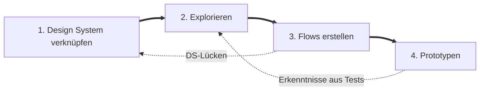

# Design als Code

**Vertiefung zu [Kapitel 5.4](README.md#54-hi-fi-generator): Man verknüpft sein Design System und exploriert, baut Flows und prototypt darauf – und jedes Design besteht aus echtem Code, aus den Komponenten des Design Systems.**

> Stand: 24.11.2026 · Paketnamen wie `@wireflow/runtime` sind Platzhalter; das Beispiel nutzt das fiktive Design System „Acme UI“.

---

## Kurzfassung

- **Der Grundablauf:** Design System verknüpfen → explorieren → Flows erstellen → prototypen. Ab dem ersten Schritt ist alles auf dem Canvas echter Code.
- **Jeder Screen ist ein Screen-Modul:** eine TSX-Datei, die nur Komponenten und Tokens des verknüpften Design Systems nutzt. Was der Canvas zeigt, ist genau dieser Code, gerendert mit den echten Komponenten.
- **Zustände sind Stories:** Leer, Laden, Fehler und Standard liegen als Storybook-Stories mit typisierten Testdaten neben dem Screen.
- **Navigation bleibt im Flow:** Ein Screen löst nur Trigger aus; wohin es geht, steht im Flow-Modell. So bleibt der Wireflow auf dem Canvas bearbeitbar, ohne Code anzufassen.
- **Mit dem Design System gestalten:** Komponenten aus der Bibliothek auf den Canvas ziehen, anordnen und im Inspector einstellen – jede Aktion ist eine Code-Änderung. Entwickler:innen bearbeiten dieselben Dateien in ihrer IDE.
- **Übernahme statt Handoff:** Screen-Module wandern in die App; Testdaten werden durch echte Daten ersetzt, Trigger durch Router-Navigation.

---

## 1. Der Grundablauf



| Schritt | Was passiert | Warum es echter Code ist |
|---|---|---|
| **1. Design System verknüpfen** | Repo, Paket, Storybook, Tokens, Figma oder den MCP-Server des Design Systems anbinden ([Design-System-Integration](design-system-integration.md)); das Plugin baut Manifest und Renderer-Bundle | Ab hier rendert jeder Canvas die echten Komponenten in der freigegebenen Version. |
| **2. Explorieren** | Komponenten und Patterns erkunden; Screens von Hand aus Komponenten zusammensetzen oder mit Claude mehrere Richtungen nebeneinander entwickeln | Varianten sind Screen-Module – sofort klickbar, vergleichbar, verwerfbar. |
| **3. Flows erstellen** | gewählte Richtungen zu Wireflows verbinden: Screens, Entscheidungen, Zustände nach Patterns, begründet aus dem [Nutzerkontext](nutzerkontext-und-research.md) | Jeder Screen im Flow ist ein Screen-Modul, jeder Zustand eine Story. |
| **4. Prototypen** | den Flow klickbar machen, mit Variablen und Testaufgaben, und mit echten Menschen testen | Der Prototyp läuft mit denselben Komponenten wie später die App. |

---

## 2. Was „echter Code“ heißt

| Anforderung | Umsetzung |
|---|---|
| Echte Komponenten | Imports aus dem DS-Paket in der freigegebenen Version – kein Nachbau, keine Bilder von Komponenten |
| Echtes Verhalten | Eingaben, Fokus, Validierung, Hover und Animationen kommen aus den Komponenten selbst |
| Echte Tokens und Themes | Werte nur über Tokens; Themes über die Provider des Design Systems |
| Echte Typen | Der TypeScript-Compiler prüft Komponenten und Props gegen die Typen des Design Systems |
| Echte Datenstrukturen | Testdaten folgen den Typen der API, zum Beispiel aus einer OpenAPI-Beschreibung erzeugt |
| Lesbar und übernehmbar | gewöhnliches TSX, wie es das Team selbst schreiben würde |

---

## 3. Das Screen-Modul

**Screen** – `.wireflow/screens/profil.screen.tsx`

```tsx
import { Page, AppBar, Card, Avatar, ChipGroup, Text, Button } from '@acme/ui';
import { flow } from '@wireflow/runtime';
import type { TerminAuswahl } from '../fixtures/termin';

export function ProfilTermine({ arzt, tage, zeiten }: TerminAuswahl) {
  return (
    <Page padding="space.4" gap="space.3">
      <AppBar data-wf="ab" title="Termin wählen" onBack={flow.back} />
      <Card
        data-wf="card_arzt"
        title={arzt.name}
        subtitle={`${arzt.fach} · ${arzt.adresse}`}
        media={<Avatar initials={arzt.kuerzel} />}
      />
      <ChipGroup data-wf="ch_tag" label="Tag" options={tage} defaultValue={tage[2]} />
      <ChipGroup data-wf="ch_uhr" label="Uhrzeit" options={zeiten} defaultValue={zeiten[1]} />
      <Text data-wf="tx_res" tone="muted" icon="clock">
        Wir halten den Termin 5 Minuten für Sie frei.
      </Text>
      <Button data-wf="btn_weiter" variant="primary" size="lg" onPress={flow.trigger('btn_weiter')}>
        Weiter
      </Button>
    </Page>
  );
}
```

**Zustände** – `.wireflow/screens/profil.stories.tsx`

```tsx
import type { Meta, StoryObj } from '@storybook/react';
import { ProfilTermine } from './profil.screen';
import { termin } from '../fixtures/termin';

const meta = { component: ProfilTermine } satisfies Meta<typeof ProfilTermine>;
export default meta;
type Story = StoryObj<typeof meta>;

export const Standard: Story = { args: termin.standard };
export const KeineTermine: Story = { args: { ...termin.standard, zeiten: [] } };
```

Die Stories laufen auch im Storybook des Teams – Designs und Komponentendoku liegen am selben Ort.

**Regeln für Screen-Module**

1. **Imports** nur aus dem DS-Paket, aus freigegebenen Produkt-Komponenten, aus `fixtures/` und aus der Flow-Runtime.
2. **Gestaltung** nur über Props, Varianten und Tokens – keine `style`-Attribute, kein eigenes CSS, keine HTML-Elemente außer freigegebenen.
3. **Daten** nur über typisierte Props.
4. **Navigation und Zustandswechsel** nur über `flow.trigger()`, `flow.back` und `flow.vars`. Wohin ein Trigger führt, steht im Flow-Modell.
5. **Stabile IDs** als `data-wf`-Attribut, ähnlich wie visuelle Editoren für React-Code es machen. Der Canvas vergibt und pflegt sie; in der Code-Ansicht lassen sie sich ausblenden, und beim Übernehmen in die App entfernt sie ein Codemod.
6. **Alles andere** ist erlaubt, wird aber zum **Code-Block**: Der Canvas zeigt ihn an, bearbeitet ihn aber nicht strukturell, und der Lint markiert ihn.

---

## 4. Fidelity ohne Wegwerf-Wireframes

Weil ein Screen von Anfang an echter Code ist, muss er nicht für Hi-Fi neu gebaut werden. Fidelity wird zu einem Token-Modus und einer Frage der Vollständigkeit:

| Stufe | Was es ist | Echter Code? |
|---|---|---|
| **Skizze** | freie Idee auf der Skizzen-Ebene, etwa für etwas, das das Design System noch nicht kann | nein – bewusst nur Idee |
| **Wireframe** | Screen-Modul mit echten Komponenten im Token-Modus „wireframe“: neutral, grau, ohne Bilder | ja |
| **Hi-Fi** | dasselbe Screen-Modul im Marken-Theme mit vollständigen Inhalten | ja |

Der Wechsel zwischen Wireframe und Hi-Fi tauscht nur den Token-Modus. IDs, Kommentare, Verbindungen und Interaktionen bleiben erhalten.

---

## 5. Explorieren mit echten Komponenten

- **Design System erkunden:** Komponenten-Galerie und Pattern-Karten liegen direkt auf dem Canvas. Zu einer Situation („Liste kann leer sein“) zeigt Claude die passenden Patterns.
- **Richtungen entwickeln:** „Zeig drei Richtungen für die Ergebnisliste“ erzeugt drei Screen-Module nebeneinander – jedes sofort klickbar, mit DS-Score, Pattern-Grundlage und Wissensstand aus dem Nutzerkontext.
- **Vergleichen:** Varianten lassen sich im Prototyp-Modus direkt gegeneinander durchklicken und im Team bewerten.
- **Über das Design System hinaus:** Was das DS nicht abdeckt, darf als Skizze oder als Produkt-Komponente aus DS-Bausteinen entstehen. Beides wird als DS-Lücke markiert. So begrenzt das DS die Exploration nicht, aber jede Abweichung bleibt sichtbar.
- **Schnell, weil komponiert statt gezeichnet:** Claude setzt bekannte Komponenten zusammen, statt Pixel zu zeichnen. Eine neue Richtung kostet Sekunden, nicht Stunden.

---

## 6. Mit dem Design System gestalten

Gestalten heißt hier: echte Komponenten auf dem Canvas anordnen – von Hand, mit Claude oder beides im Wechsel. Jede Aktion ist eine Änderung am Screen-Modul.

| Aktion | So funktioniert es | Was im Code passiert |
|---|---|---|
| **Einfügen** | Komponente aus der Bibliothek auf einen Screen oder in einen Slot ziehen; eine Linie zeigt die Position. Ohne Maus: mit + nach der Auswahl einfügen | neues JSX-Element mit Import aus dem DS-Paket |
| **Anordnen** | im Screen oder im Ebenenbaum ziehen, Alt + ↑/↓, in einen Stack einpacken oder auspacken | Elemente wandern im Syntaxbaum |
| **Einstellen** | Inspector aus den TypeScript-Typen: Varianten als Auswahl, boolesche Props als Schalter, Texte als Felder, Slots als Ablagezonen, Abstände und Farben nur als Tokens | Props im JSX ändern sich |
| **Texte** | per Doppelklick direkt im Screen bearbeiten | Text-Kinder oder Props ändern sich |
| **Duplizieren, Löschen, Rückgängig** | Strg/⌘ + D, Entf, Strg/⌘ + Z; auch über Screens hinweg kopieren | Elemente werden kopiert oder entfernt; die Historie gilt für Canvas und Code |
| **Patterns als Bausteine** | ein Pattern wie „Leerzustand“ einfügen; die Komposition folgt der Pattern-Karte | mehrere Komponenten auf einmal, regelkonform |
| **Zustände und Breakpoints** | zwischen Stories (Standard, Leer, Fehler …) und Viewports wechseln; Props pro Breakpoint setzen | Stories und responsive Props |

**Leitplanken beim Gestalten**

- **Nur erlaubte Stellen:** Ablagezonen zeigen nur Positionen, an denen eine Komponente laut Manifest stehen darf – etwa ein Listeneintrag nur in einer Liste.
- **Richtlinien melden sich live:** zum Beispiel „höchstens eine primäre Aktion pro Screen“ oder ein fehlendes Label – direkt am Element und im Qualität-Tab.
- **Kein Auflösen von Komponenten:** Anders als in Zeichen-Tools lässt sich eine Komponente nicht in Einzelteile zerlegen. Fehlt etwas, entsteht eine Produkt-Komponente oder eine DS-Lücke, die das DS-Team sieht.
- **Verbindungen sind geschützt:** Ein Element, das einen Trigger im Flow auslöst, lässt sich erst löschen, wenn die Verbindung gelöst ist.

**Mensch und Claude im Wechsel:** Menschen ordnen an, Claude füllt realistische Inhalte, ergänzt Zustände oder macht einen Screen responsive – auf derselben Datei, sichtbar als Vorschlag.

Im [Click-Dummy](prototype/index.html) lässt sich das im Design-Modus ausprobieren: Komponenten aus dem Tab „Komponenten“ auf einen Screen ziehen oder mit + einfügen, im Screen umordnen, Props im Inspector ändern, duplizieren, löschen und rückgängig machen.

**Technisch**

- **Ebenen aus dem Code:** Das Ebenen-Panel zeigt den Komponentenbaum des Screen-Moduls.
- **Änderungen als Code-Transformation:** Verschieben, Props ändern, Komponenten einfügen – jede Aktion wird als Transformation am Syntaxbaum geschrieben (zum Beispiel über die TypeScript-Compiler-API) und mit Prettier formatiert. Die Diffs bleiben lesbar.
- **Live im Team:** Im Raum liegt der Komponentenbaum als CRDT, damit gleichzeitige Änderungen sauber zusammengeführt werden. „Version sichern“ schreibt ihn deterministisch als TSX; beim Laden wird das TSX wieder eingelesen. Innerhalb der Regeln aus Kapitel 3 geht dabei nichts verloren.
- **IDE und Canvas:** Ändern Entwickler:innen ein Screen-Modul in der IDE, übernimmt der Canvas das. Liegt die Änderung außerhalb der Regeln, wird sie zum Code-Block.
---

## 7. Claude schreibt Code

Claude erzeugt Screen-Module direkt als TSX und prüft jede Fassung, bevor sie als Vorschlag erscheint:

1. **Typprüfung** gegen das DS-Paket (`tsc --noEmit`),
2. **Lint-Regeln** für Screen-Module: nur DS-Komponenten, nur Tokens, keine `style`-Attribute,
3. **Rendern** mit Screenshot und A11y-Prüfung (axe-core),
4. **Pattern- und Evidenz-Prüfung** gegen Pattern-Karten und Wissensbasis.

Fehler gehen als Rückmeldung an Claude zurück (Hook nach dem Schreiben), bis alles besteht. Fehlt im Design System eine passende Komponente, entsteht eine Produkt-Komponente aus DS-Bausteinen – als DS-Lücke markiert und als Vorschlag für das DS-Team.

---

## 8. Rendern und Prototyp

- **Renderer-Bundle:** Das DS mit seinen Providern liegt als vorgebautes Paket auf dem Team-Server. Screen-Module baut der Team-Server bei jeder Änderung inkrementell (zum Beispiel mit esbuild) und liefert sie an alle Canvas-Instanzen. Lokal übernimmt das der Vite-Renderer des Plugins.
- **Sandbox:** Jeder Screen läuft in einem isolierten iframe mit denselben Providern wie in der App.
- **Flow-Runtime:** Im Prototyp löst `flow.trigger()` die Kanten des Flow-Modells auf – inklusive Entscheidungen über `flow.vars`. Derselbe Screen-Code läuft so im Wireflow, im Prototyp und im Storybook.

---

## 9. Vom Prototyp ins Produkt

- **Übernehmen:** Screen-Module werden in die App übernommen. Testdaten werden durch echte Datenanbindung ersetzt, `flow.trigger` durch Router-Navigation (über einen Adapter der Flow-Runtime), `data-wf`-Attribute entfernt ein Codemod.
- **Oder direkt nutzen:** Teams, die es wollen, importieren Screen-Module unverändert in die App. Dann ist Design-Code Produkt-Code.
- **Tests:** Playwright-Tests aus den Flows laufen gegen dieselben Screens.
- **Figma bleibt optional**, etwa zum Präsentieren – es ist nicht mehr die Quelle.

---

## 10. Grenzen

- Neue visuelle Sprache und Illustrationen gehören nicht in Screen-Module, sondern in den Prozess des Design Systems.
- Andere Frameworks als React brauchen eigene Modulformate und Renderer (etwa Vue Single-File-Components oder Web Components).
- Komponenten, die selbst Daten laden oder globale Abhängigkeiten haben, brauchen Mocks im Renderer.

---

## Quellen

- Storybook: [Component Story Format (CSF)](https://storybook.js.org/docs/api/csf)
- [TypeScript Compiler API](https://github.com/microsoft/TypeScript/wiki/Using-the-Compiler-API) · [esbuild](https://esbuild.github.io) · [Prettier](https://prettier.io)
