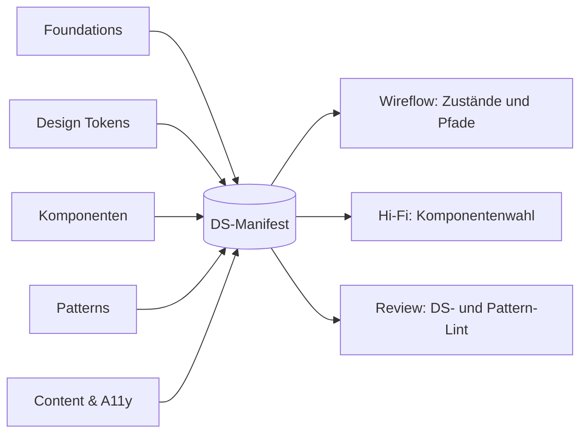
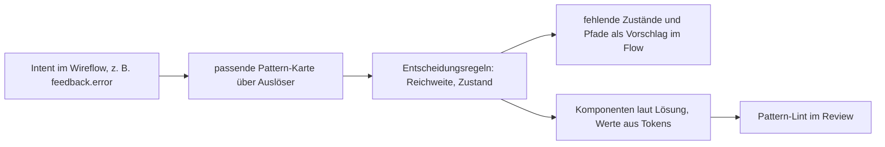

# Design-System-Integration

**Vertiefung zu [Kapitel 5.3](README.md#53-design-system-als-fundament): Wie Wireflow Studio ein bestehendes Design System anbindet – am Beispiel von Primer, dem Design System von GitHub.**

> Stand: 23.11.2026 · Angaben zu Primer beruhen auf der öffentlichen Doku (primer.style) und den npm-Paketen; Details können sich mit neuen Versionen ändern.

---

## Kurzfassung

- Ein Design System besteht für das Plugin aus **fünf Wissensschichten**: Foundations, Design Tokens, Komponenten, **Patterns** sowie Content- und A11y-Regeln – dazu Metadaten wie Version, Status und Owner.
- Tokens und Komponenten sind meist schon maschinenlesbar. **Patterns liegen fast immer als Prosa vor** – und sind trotzdem die wertvollste Schicht. Das Plugin übersetzt sie deshalb in **Pattern-Karten** mit Auslösern, Entscheidungsregeln und Folgen für den Flow.
- Patterns sind die Brücke vom Wireflow zum Hi-Fi: **Intent → Pattern → Komponenten**. Sie bestimmen außerdem, welche Zustände und Pfade ein Flow braucht.
- Die Integration läuft in sieben Schritten: verbinden, extrahieren, normalisieren, anreichern, kuratieren, verifizieren, synchron halten. Ergebnis ist das **DS-Manifest** – kuratiert vom DS-Team, versioniert im Repo.



---

## 1. Was das Plugin pro Schicht wissen muss

| Schicht | Muss vorhanden sein | Sollte vorhanden sein | Wofür das Plugin es nutzt |
|---|---|---|---|
| **Foundations** | Farbrollen (wofür welche Farbe), Typostile mit Einsatzzweck, Breakpoints und Raster, Abstandsskala | Elevation, Motion, Icon-Set mit Bedeutungen, Dichte | Layoutentscheidungen, Lint-Regeln, Kontrastpaare |
| **Design Tokens** | semantische Tokens mit Typ und Wert pro Modus, Aliase | Basis-Tokens klar getrennt, Deprecations mit Ersatz, Figma-Zuordnung, Nutzungshinweise | Hi-Fi-Werte nur aus Tokens, Themes, DS-Lint |
| **Komponenten** | Name, Importpfad, Props mit Typen, Pflichtfeldern und Defaults, Varianten, Reifegrad | Unterkomponenten und erlaubte Verschachtelung, Zustände, A11y-Vertrag, „wann nutzen / wann nicht“, Beispiele (Stories), Code-Connect | Validierung der Screen-IR, Renderer, Inspector |
| **Patterns** | Problem und Auslöser, Lösung (welche Komponenten in welcher Struktur), Entscheidungsregeln | Zustände und Pfade, die das Pattern verlangt, Content-Vorlagen, A11y-Verhalten, Beispiele, Anti-Patterns | Flow-Erzeugung, Komponentenwahl, Pattern-Lint |
| **Content & A11y** | Tonalität, Terminologie, Schreibweisen, WCAG-Zielniveau | Microcopy-Vorlagen (Fehler, Leerzustände), Längen und Kürzungsregeln, Lokalisierung | Texte im Hi-Fi, Content-Lint, A11y-Gate |
| **Metadaten** | Version, Reifegrad-Definitionen | Changelog, Migrationshinweise, Owner | Aktualität, Deprecation-Hinweise, Freigaben |

**Faustregel:** Ohne Komponenten und Tokens kann das Plugin nicht arbeiten. Ohne Patterns arbeitet es – aber jeder Screen löst dieselbe Situation ein bisschen anders. Genau das soll ein Design System verhindern.

---

## 2. Patterns: die wichtigste Schicht

### 2.1 Warum Patterns entscheidend sind

Komponenten beantworten die Frage *womit*. Patterns beantworten *was in welcher Situation* – und genau diese Frage stellt sich beim Gestalten von Flows ständig: Wie melde ich einen Fehler? Was zeigt eine leere Liste? Was passiert beim Speichern?

Im Plugin wirken Patterns auf drei Ebenen:

1. **Wireflow:** Sie legen fest, welche Zustände und Pfade ein Flow braucht. Ein Screen mit Speichern-Aktion bekommt die Zustände des Saving-Patterns; eine Liste bekommt ihren Leerzustand.
2. **Hi-Fi:** Sie entscheiden, welche Komponente in welcher Situation passt – nach festen Regeln statt nach Geschmack.
3. **Review:** Abweichungen werden erkennbar („Erfolgsmeldung nach Routine-Speichern – laut Pattern sparsam einsetzen“).

**Beispiel Primer:** Die UI-Patterns von Primer übersetzen sich direkt in Anforderungen an Flow und Hi-Fi (sinngemäß aus der Primer-Doku, gekürzt):

| Primer-Pattern | Was es im Wireflow verlangt | Was es im Hi-Fi entscheidet |
|---|---|---|
| Saving | Zustände für ungespeichert, speichert, gespeichert und Fehler, dazu einen Weg zurück nach einem Fehler | Änderungen schnell und eindeutig sichtbar machen, Vertrauen schaffen |
| Empty states | eine Leer-Variante für jede Liste oder Ansicht ohne Inhalt | erklären, was das Feature tut, und die Absicht vermitteln |
| Notification messaging | welche Meldungen es gibt – nach Reichweite und Zustand | Banner für Seite oder Abschnitt, InlineMessage für eine einzelne Aktion oder ein Feld; sechs Zustände (info, warning, success, unavailable, critical, upsell) mit festem Icon und Farbe; Erfolgsmeldungen sparsam |
| Forms | den Validierungsablauf inklusive Fehlerpfad | Feldfeedback inline; bei Fehlern in mehreren Feldern zusätzlich ein Banner |
| Loading | Ladezustände für asynchrone Schritte | Wartende informiert halten |
| Degraded experiences | Fallback-Zustände, wenn optionale Dienste ausfallen | Primärinhalt zeigen, betroffene Sekundärinhalte und Navigationspunkte ausblenden, globale Navigation immer sichtbar, keine kaputten Links |
| Feature onboarding | eine Sequenz mit klarem Anfang und Ende, die nie blockiert | Onboarding-UI auf der Hierarchieebene des Features |
| Progressive disclosure | optionale Verzweigungen wie „Details zeigen“ | sparsam einsetzen, nur wenn Kürzen nötig ist |
| Navigation | Orientierung: wo bin ich, wohin kann ich | Skip-Links für Screenreader |

### 2.2 Die Pattern-Karte

Jedes Pattern liegt als eigene Datei in `.wireflow/ds/patterns/` – Markdown mit YAML-Kopf. Der Kopf ist für Claude und die Lint-Regeln, der Text darunter für Menschen. So bleibt die Karte im Pull Request lesbar und vom DS-Team pflegbar.

```markdown
---
id: notification-messaging
name: Notification messaging
quelle: https://primer.style/product/ui-patterns/notification-messaging
status: stable
owner: ds-team
ausloeser:                      # wann Claude das Pattern anwendet
  - intent: feedback.*
  - ereignis: system.fehler
entscheidung:                   # Regeln in fester Reihenfolge
  - wenn: { reichweite: [seite, abschnitt] }
    nutze: Banner
  - wenn: { reichweite: [feld, aktion] }
    nutze: InlineMessage
  - wenn: { fehler: mehrere-felder }
    nutze: [InlineMessage, Banner]
zustaende: [info, warning, success, unavailable, critical, upsell]
regeln:
  - Erfolg sparsam melden; oft reicht der Kontext der Interaktion.
  - Jeder Zustand hat eine feste Kombination aus Icon und Farbe.
a11y:
  - Banner braucht einen Titel; er ist der zugängliche Name.
beispiele: [stories/banner--critical, screens/slot-vergeben]
verwandt: [forms, saving]
---

Erläuterung, Do's und Don'ts sowie Bilder – verlinkt auf die Primer-Doku statt kopiert.
```

Patterns, die Zustände im Flow verlangen, beschreiben diese direkt in der Karte:

```yaml
id: saving
ausloeser: [{ intent: action.save }]
flow:
  zustaende: [ungespeichert, speichert, gespeichert, fehler]
  pfade:
    - { von: fehler, nach: ungespeichert, trigger: erneut-versuchen }
```

### 2.3 Woher Patterns kommen

1. **Doku des Design Systems:** Claude erstellt aus Seiten wie den Primer-UI-Patterns Entwürfe für Pattern-Karten. Das DS-Team prüft und gibt sie frei.
2. **MCP-Server des Design Systems:** Primer bietet mit `@primer/mcp` einen eigenen MCP-Server mit Tools wie `list_patterns` und `get_pattern`. Das Plugin fragt dort live nach, statt Webseiten auszulesen.
3. **Produkteigene Patterns:** Viele Muster gibt es nur im Produkt, nicht im DS – etwa „Termin fünf Minuten reservieren“. Das Plugin findet wiederkehrende Kompositionen in Code und Screens und schlägt vor, sie als Pattern zu dokumentieren.
4. **Pattern-Lücken:** Kommt im Flow eine Situation vor, für die es kein Pattern gibt, markiert das Plugin eine Pattern-Lücke – analog zur DS-Lücke bei Komponenten.

### 2.4 Wie Claude Patterns anwendet



Im Click-Dummy ist das der Fehlerzustand „Slot vergeben“: Die Entscheidung „Slot noch frei?“ braucht laut Pattern einen Fehlerpfad, die Meldung nutzt eine Fehlervariante aus dem DS, und die Eingaben bleiben erhalten.

---

## 3. Ablauf der Integration

| Schritt | Was passiert | Ergebnis |
|---|---|---|
| **1. Verbinden** | `/wireflow:ds connect` erkennt Quellen: DS-Pakete in `package.json`, Token-Dateien, Storybook, MCP-Server des Design Systems, Figma-Bibliothek, Doku-URL | Liste der Quellen mit Version |
| **2. Extrahieren** | ein Adapter pro Quelle (Tabelle unten) | Rohfakten je Schicht |
| **3. Normalisieren** | alles in ein gemeinsames Manifest-Schema, mit Herkunft und Konfidenz pro Fakt | `.wireflow/ds/manifest.json` |
| **4. Anreichern** | Claude ordnet Intents zu, fasst „wann nutzen“ zusammen, entwirft Pattern-Karten und markiert Lücken | Entwürfe, deutlich als solche gekennzeichnet |
| **5. Kuratieren** | das DS-Team prüft den Manifest-Diff im Pull Request (CODEOWNERS) | freigegebenes Manifest |
| **6. Verifizieren** | Render-Test: jede Komponente mit Beispiel-Props in allen Modi; Token-Auflösung prüfen; Screenshot-Galerie | Nachweis, dass alles renderbar ist |
| **7. Synchron halten** | Versionswechsel erkennen, Manifest-Diff zeigen, Deprecations mit Migrationshinweisen | „DS-Update verfügbar“ an betroffenen Screens |

**Adapter**

| Quelle | Adapter | Liefert |
|---|---|---|
| Komponentenpakete im Repo oder als npm-Paket | TypeScript-Analyse | Props, Varianten, Importpfade |
| Storybook | Components-Manifest (`/manifests/components.json`) oder das Storybook-MCP-Addon | Beispiele, Doku, Props (derzeit Preview, nur React) |
| MCP-Server des Design Systems | MCP-Client | Patterns, A11y-Richtlinien, Token-Nutzung, Lint |
| Token-Dateien | DTCG-Parser inklusive `$extensions` | Tokens, Modi, Figma-Zuordnung |
| Figma | Figma-MCP-Server | Variablen, Komponenten, Code Connect |
| Doku-Website oder MDX | Abruf plus Extraktion durch Claude | Foundations, Patterns, Content-Regeln |

---

## 4. Beispiel: Primer anbinden

| Schicht | Primer-Quelle | Was das Plugin daraus macht |
|---|---|---|
| Foundations | primer.style, Bereich Foundations | Regeln für Farbrollen, Typografie, Layout und Barrierefreiheit |
| Design Tokens | `@primer/primitives`: Basis- und funktionale Tokens mit `$value`, `$type` und `$extensions` (darin Figma-Metadaten); per Style Dictionary auch als CSS-Variablen | Token-Teil des Manifests; im Hi-Fi nur funktionale Tokens; Themes (Light, Dark und weitere, etwa mit hohem Kontrast) als Modi |
| Komponenten | `@primer/react` in TypeScript; je Komponente eine `*.docs.json` mit Status, Story-IDs und A11y-Prüfvermerk; Storybook | Komponentenkatalog mit Reifegrad; im Standard nur stabile Komponenten |
| Patterns | primer.style, Bereich UI patterns | Pattern-Karten wie in Kapitel 2 |
| Icons | Octicons | Icon-Katalog mit Bedeutung |
| Agent-Zugriff | `@primer/mcp` mit Tools wie `list_components`, `get_component_accessibility_guidelines`, `list_patterns`, `get_pattern`, `get_token_usage_patterns`, `get_color_usage`, `lint_css` | Primer wird live abgefragt; `lint_css` ergänzt den DS-Lint |

**Was bei Primer konkret zu beachten ist**

- **Reifegrade ernst nehmen:** Primer kennzeichnet Komponenten mit Reifegraden von experimentell bis veraltet. Der neuere Banner ist in der React-Doku noch als Entwurf unter `@primer/react/experimental` beschrieben. Das Manifest übernimmt den Status, und eine Team-Regel legt fest, ob Claude experimentelle Komponenten nutzen darf.
- **Deprecations mit Migration:** Flash ist zugunsten von Banner veraltet – und Banner ist kein 1:1-Ersatz (Hauptaussage in `title`, Details in `description`). Solche Hinweise gehören ins Manifest, damit Claude bestehende Screens beim Update korrekt umbaut.
- **Funktionale statt Basis-Tokens:** Basis-Tokens bilden direkt Rohwerte ab. In Screens sind nur funktionale Tokens erlaubt; der Lint meldet Basis-Tokens wie freie Werte.
- **Provider im Renderer:** Primer React braucht ein Provider-Setup (z. B. `ThemeProvider` und `BaseStyles`). Das gehört in den Renderer-Wrapper aus `wireflow.config.ts`, sonst rendern Hi-Fi-Screens ohne Theme.
- **Ein Manifest, mehrere Implementierungen:** Primer gibt es nicht nur für React. Das Manifest kann pro Komponente mehrere Implementierungen führen; der Code-Export wählt die passende.

**Manifest-Eintrag (Auszug, vereinfacht)**

```json
{
  "id": "Banner",
  "status": "experimental",
  "implementierung": { "react": "import { Banner } from '@primer/react/experimental'" },
  "props": {
    "title": { "type": "string", "required": true },
    "description": { "type": "ReactNode" },
    "variant": { "enum": ["info", "warning", "success", "unavailable", "critical", "upsell"] },
    "onDismiss": { "type": "function" },
    "primaryAction": { "type": "ReactNode" },
    "secondaryAction": { "type": "ReactNode" }
  },
  "intents": ["feedback.page", "feedback.section"],
  "patterns": ["notification-messaging"],
  "ersetzt": ["Flash"],
  "a11y": ["title ist der zugängliche Name"],
  "herkunft": { "paket": "@primer/react", "doku": "primer.style" }
}
```

---

## 5. Wann ist ein Design System bereit für Claude?

`/wireflow:ds audit` bewertet jede Schicht und zeigt, was fehlt:

- [ ] Komponenten mit typisierten Props und Reifegrad
- [ ] Semantische Tokens mit Modi, Basis-Tokens getrennt
- [ ] Patterns mit Auslösern und Entscheidungsregeln, nicht nur als Fließtext
- [ ] A11y-Vertrag pro Komponente
- [ ] Content-Regeln mit Beispielen
- [ ] Beispiele (Stories) für jede Variante
- [ ] Changelog und Deprecations mit Ersatz
- [ ] Renderbar im Projekt, Provider-Setup dokumentiert

Primer erfüllt einen Großteil davon bereits. Bei den meisten Unternehmens-Design-Systemen fehlen vor allem strukturierte Patterns und Reifegrade.

---

## 6. Wenn Informationen fehlen

| Es fehlt … | Das Plugin … |
|---|---|
| **Patterns** | leitet Kandidaten aus bestehenden Screens und Code ab, nutzt bis zur Freigabe allgemeine UX-Heuristiken mit niedriger Konfidenz und markiert betroffene Screens als „ohne Pattern-Grundlage“ |
| **Tokens** | liest CSS-Variablen oder ein Tailwind-Theme aus oder übernimmt Figma-Variablen; freie Werte werden zu Token-Vorschlägen |
| **Code** (DS nur in Figma) | nutzt den Figma-MCP-Server und rendert über Figma oder den Token-Renderer |
| **Doku** (DS nur als Code) | entwirft aus Typen und Stories Doku-Texte und Pattern-Entwürfe; das DS-Team kuratiert |

---

## Quellen

- Primer: [UI patterns](https://primer.style/product/ui-patterns) · [Notification messaging](https://primer.style/product/ui-patterns/notification-messaging/) · [Primitives](https://primer.style/foundations/primitives) · [MCP server](https://primer.style/product/getting-started/foundations/mcp) · [Migration Flash → Banner](https://primer.style/product/getting-started/react/migration-guides/primer-flash) · [Komponentenstatus](https://primer.style/react/status) · [primer/primitives](https://github.com/primer/primitives)
- Storybook: [AI-Manifeste](https://storybook.js.org/docs/ai/manifests) · [Storybook MCP](https://storybook.js.org/docs/ai/mcp/overview)
- Design Tokens Community Group: [Format Module 2025.10](https://www.designtokens.org/tr/2025.10/)
