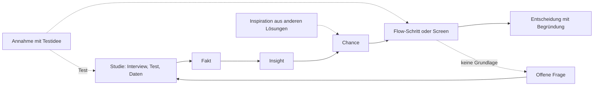

# Nutzerkontext, Research und Innovation

**Vertiefung zu [Kapitel 5.1](README.md#51-nutzerkontext-und-journey-mapper): das Warum hinter jedem Flow – was das Team über Nutzer:innen und Domain weiß, was es nur annimmt und was es noch nicht weiß.**

> Stand: 23.11.2026 · Das Beispiel „Arzttermin buchen“ ist fiktiv und entspricht dem Click-Dummy.

---

## Kurzfassung

- **Der Kern ist der Nutzerkontext:** das Wissen des Teams über seine Nutzer:innen, ihre Situationen und die Domain. Das Design System sichert die Umsetzung – das Warum entscheidet, *was* umgesetzt wird.
- **Flows abbilden, Annahmen auf Research gründen:** Jeder Screen, jede Verbindung und jede Entscheidung im Flow trägt ihre Grundlage – einen Insight mit Belegen, eine ausdrücklich markierte Annahme oder den Vermerk „offen“.
- **Bekannt, angenommen, unbekannt** sind auf dem Canvas jederzeit sichtbar. Die riskantesten Annahmen werden zuerst geprüft.
- **Menschen urteilen:** Kontext und menschliches Urteilsvermögen entscheiden über Nutzerzentrierung. Claude sammelt, ordnet, verknüpft und fragt nach – erfindet aber kein Nutzerwissen.
- **KI öffnet den Blick:** Claude recherchiert ähnliche Lösungen und Analogien aus anderen Domains und entwickelt bewusst unterschiedliche Konzeptrichtungen. Das Team bewertet, was übertragbar ist.



---

## 1. Das Warum als Kette

Das Plugin übernimmt das Prinzip der **Atomic UX Research** (Daniel Pidcock, Tomer Sharon): Studien liefern **Fakten** – Beobachtungen ohne Interpretation. **Insights** deuten einen oder mehrere Fakten, auch aus verschiedenen Studien. Aus Insights entstehen **Chancen**. Je mehr Insights eine Chance stützen, desto stärker ist sie.

Wireflow Studio verlängert diese Kette bis in die Gestaltung: **Chance → Flow-Schritt → Screen → Element → Entscheidung**. Jede Verbindung ist eine ID-Referenz. Deshalb kann jedes Element auf dem Canvas auf „Warum?“ antworten – mit dem Weg zurück bis zu den Fakten und ihren Quellen.

---

## 2. Was das Team wissen sollte

| Baustein | Inhalt | Ablage im Repo | Pflegt |
|---|---|---|---|
| **Nutzer:innen und Kontext** | Segmente oder Personas, Jobs-to-be-done, Nutzungssituationen (Ort, Zeit, Gerät, Stress, Barrieren), Ziele, Frustrationen | `knowledge/users/` | Research |
| **Domain** | Glossar, fachliche Regeln und Vorgaben (z. B. rechtliche), Prozesse, Akteure, Randbedingungen | `knowledge/domain/` | Fachexpert:innen, Produkt |
| **Studien und Fakten** | Studien mit Methode, Datum und Stichprobe; Fakten mit Quelle (Datei und Zeilen) | `knowledge/studies/` | Research |
| **Insights** | Deutung mit Verweisen auf Fakten und Wissensstand | `knowledge/insights/` | Research mit dem Team |
| **Annahmen** | was das Team glaubt, ohne es belegt zu haben – mit Kategorie, Wichtigkeit, Evidenzstand und Testidee | `knowledge/assumptions/` | ganzes Team; Claude schlägt vor |
| **Offene Fragen** | Wissenslücken mit Forschungsfrage und passender Methode | `knowledge/questions/` | Research |
| **Inspirationen** | ähnliche Lösungen und Analogien mit Quelle, Mechanismus und Übertragbarkeit | `knowledge/inspiration/` | Claude recherchiert, das Team bewertet |
| **Entscheidungen** | was entschieden wurde, warum und auf welcher Grundlage | `decisions/` | Team |

**Teamwissen zählt – aber anders:** Hinweise aus Support, Vertrieb oder von Fachexpert:innen sind wertvoll und werden aufgenommen, tragen aber den Quellentyp „Teamwissen“. So bleibt erkennbar, was aus Research stammt und was aus Erfahrung.

---

## 3. Flows abbilden – Annahmen auf Research gründen

### 3.1 Jeder Schritt mit Grundlage

Jedes Element im Flow verweist auf seine Grundlage: einen Insight mit Belegen, eine Annahme oder nichts. Im Beispiel „Arzttermin buchen“:

| Flow-Element | Grundlage | Wissensstand |
|---|---|---|
| „Slot noch frei?“ mit Fehlerpfad | Insight „Slots werden zwischen Auswahl und Absenden vergeben“ (Interviews P03, P07, P11) | belegt |
| Slot fünf Minuten reservieren | Inspiration aus dem Ticketing (Platz mit Zeitlimit) und Annahme „fünf Minuten reichen bis zur Buchung“ | Annahme – im Prototyp testen |
| Anmeldung vor dem Prüfen | Annahme „Praxen brauchen ein Konto, um Termine zuzuordnen“ | Annahme – mit Fachexpert:innen klären |
| Gastbuchung | keine Daten | offen |

### 3.2 Wissensstand sichtbar machen

| Stufe | Bedeutung | Darstellung auf dem Canvas |
|---|---|---|
| **Belegt** | mehrere unabhängige Fakten oder belastbare Daten | grün |
| **Hinweis** | ein einzelner Fakt oder eine kleine Stichprobe | hellgrün |
| **Annahme** | plausibel, aber ohne Evidenz | gelb |
| **Offen** | Wissenslücke, keine Grundlage | grau, gestrichelt |
| **Widerspruch** | Fakten widersprechen sich oder einer Annahme | rot |

Das **Evidenz-Overlay** färbt Journey, Flows und Screens nach Wissensstand. Ein Klick zeigt die Kette bis zu den Fakten. So sieht das ganze Team auf einen Blick, wo ein Flow auf festem Boden steht und wo auf Vermutungen.

### 3.3 Annahmen priorisieren

Das Annahmen-Register folgt dem **Assumptions Mapping** von David J. Bland: Annahmen werden als Hypothesen formuliert, nach Kategorie eingeordnet (wünschenswert, machbar, tragfähig) und nach **Wichtigkeit** und **vorhandener Evidenz** sortiert. Was wichtig und kaum belegt ist, wird zuerst geprüft.

- Claude schlägt für jede kritische Annahme eine Testmethode vor (Interview, Prototyp-Test, Datenauswertung) und entwirft Forschungsfragen oder Testaufgaben. Was davon umgesetzt wird, entscheidet das Team.
- Ergebnisse fließen zurück: Prototyp-Tests (Testmodus, [Kapitel 5.6](README.md#56-prototyping)) erzeugen neue Fakten, Annahmen werden bestätigt oder widerlegt, und betroffene Flows bekommen einen Vorschlag zur Anpassung.
- Eine Annahme kann auch bewusst akzeptiert werden, etwa aus Zeitgründen. Das ist eine Entscheidung und wird mit Begründung festgehalten.

### 3.4 Regeln für Claude

- **Kein erfundenes Nutzerwissen:** Aussagen über Nutzer:innen brauchen eine Quelle. Fehlt sie, legt Claude eine Annahme an statt einer Behauptung.
- **Synthetisches ist keine Evidenz:** Simulierte Nutzer, Persona-Walkthroughs und KI-generierte Antworten taugen höchstens, um Hypothesen zu bilden – nie als Beleg. Die Nielsen Norman Group kommt zum selben Schluss.
- **Lücken benennen statt füllen:** Fehlt Wissen, fragt Claude nach oder legt eine offene Frage an.
- **Widersprüche zeigen:** Passt ein neuer Fakt nicht zu einem Insight oder einer Annahme, wird das markiert; betroffene Flows bekommen einen Hinweis.
- **Herkunft sichtbar:** Jede Aussage zeigt Quelle, Quellentyp und Datum.

---

## 4. Kontext und menschliches Urteil

Nutzerzentrierung entsteht nicht aus Daten allein, sondern aus Kontext und Urteilsvermögen. Das Plugin macht diese **Urteilspunkte** ausdrücklich:

| Urteilspunkt | Was Claude vorbereitet | Wer entscheidet |
|---|---|---|
| Welche Pain Points zählen | Übersicht mit Belegen, Häufigkeit und Schweregrad | Team, Research |
| Ob eine Inspiration übertragbar ist | Mechanismus, Quelle, Unterschiede zum eigenen Kontext | Team, Fachexpert:innen |
| Abwägungen (z. B. Sicherheit gegen Bequemlichkeit) | Optionen mit Für und Wider und dem, was unbekannt ist | Produkt, Design |
| Wer ausgeschlossen wird | Hinweise auf Randgruppen: ohne Smartphone, mit Behinderungen, mit Sprachbarrieren | Team |
| Ob etwas „gut genug belegt“ ist | Wissensstand und offene Risiken | Research, Produkt |

Jede Entscheidung landet mit ihrer Grundlage im Entscheidungs-Log – auch, wenn sie gegen die Daten fällt.

---

## 5. Innovation mit KI

### 5.1 Recherche zu ähnlichen Lösungen

Claude recherchiert auf Anfrage oder bei einer neuen Chance, wie andere das Problem lösen:

- **Direkt:** Produkte, die denselben Job erledigen.
- **Analog:** andere Domains mit ähnlicher Struktur – etwa Ticketing, Restaurant-Reservierung, Flug-Check-in, Carsharing.
- **Wissen:** Pattern-Sammlungen, HCI-Forschung, öffentliche Fallstudien.
- **Kritik:** öffentliche Rezensionen und Beschwerden über bestehende Lösungen.

Daraus entstehen **Inspiration-Karten**: Quelle mit Datum, der abstrahierte **Mechanismus** (warum es funktioniert), vorhandene Belege, der Bezug zu einem Insight oder Pain Point, die Übertragbarkeit (vom Team bewertet) und Risiken.

**Beispiel „Arzttermin buchen“:**

| Analogie | Mechanismus | Idee für den Flow |
|---|---|---|
| Ticketing | Platz mit Zeitlimit reservieren | Slot fünf Minuten halten – Dauer im Prototyp testen |
| Gastronomie und Flugbuchung | Warteliste mit Benachrichtigung | Warteliste für frühere Termine |
| Mobilitätsdienste | Erinnerung mit Absage per Klick | freie Slots kommen schneller zurück ins System |

**Regeln:** Quellen werden immer genannt. Übernommen wird der Mechanismus, nicht das Interface. Screenshots fremder Produkte bleiben intern und dienen nur als Referenz.

### 5.2 Erst öffnen, dann schließen

- **Öffnen:** Claude formuliert aus Pain Points „Wie könnten wir …?“-Fragen, entwickelt drei bis fünf deutlich unterschiedliche Konzeptrichtungen als Flows aus echten DS-Komponenten und dreht Annahmen bewusst um („Was wäre, wenn es keine festen Termine gäbe?“).
- **Auf Basis des Design Systems:** Exploriert wird mit dem verknüpften Design System – jede Richtung ist sofort klickbar. Ideen, die das DS nicht abdeckt, bleiben als Skizze oder Produkt-Komponente erlaubt und werden als DS-Lücke zum Vorschlag fürs DS-Team.
- **Schließen:** Das Team bewertet die Richtungen auf dem Canvas – mit Kommentaren, Stimmen und gegen Insights und Belege. Die gewählte Richtung geht in Hi-Fi aus dem Design System; die Entscheidung wird festgehalten.

### 5.3 Subagent `research-scout`

Recherchiert ähnliche Lösungen mit den Web-Werkzeugen von Claude Code, legt Inspiration-Karten an, kennzeichnet Unsicherheit und gibt Marketing-Aussagen nie als Evidenz aus. Mehrere Recherchen laufen parallel.

---

## 6. Datenmodell (Auszug)

**Insight**

```json
{
  "id": "ins_slot_weg",
  "aussage": "Slots werden zwischen Auswahl und Absenden vergeben; Eingaben gehen verloren.",
  "fakten": ["p03#41-44", "p07#18", "p11#63-65"],
  "wissensstand": "belegt",
  "chancen": ["ch_slot_halten"],
  "betrifft": ["dec_slot", "scr_slot_vergeben"]
}
```

**Annahme**

```json
{
  "id": "ann_slot_5min",
  "aussage": "Fünf Minuten Reservierung reichen, um die Buchung abzuschließen.",
  "kategorie": "wünschenswert",
  "wichtigkeit": "hoch",
  "evidenz": "keine",
  "herkunft": "knowledge/inspiration/ticketing-zeitlimit.md",
  "betrifft": ["scr_profil#tx_res"],
  "test": { "methode": "Prototyp-Test", "frage": "Wie lange brauchen Neupatient:innen bis zur Buchung?" },
  "status": "offen"
}
```

---

## 7. Abläufe im Team

1. **Research-Synthese auf dem Canvas:** Fakten werden zu Insights gebündelt. Claude schlägt Cluster vor, das Team entscheidet.
2. **Annahmen-Review vor Hi-Fi:** Welche kritischen Annahmen sind ungeprüft? Research planen – oder das Risiko bewusst akzeptieren und dokumentieren.
3. **Inspirations-Session:** Claude bringt Analogien mit Quellen, Fachexpert:innen und Team bewerten die Übertragbarkeit.
4. **Lernschleife:** Tests mit echten Menschen erzeugen Fakten; der Wissensstand der Flows aktualisiert sich.
5. **Evidenz-Gate vor der Umsetzung:** Kritische Annahmen sind geprüft oder bewusst akzeptiert.

---

## Quellen

- Nielsen Norman Group: [Synthetic Users: If, When, and How to Use AI-Generated „Research“](https://www.nngroup.com/articles/synthetic-users/) · [Synthetic Users vs. Human Respondents](https://www.nngroup.com/articles/synthetic-users-vs-human-respondents/)
- Strategyzer: [How assumptions mapping can focus your teams on running experiments that matter](https://strategyzer.com/library/how-assumptions-mapping-can-focus-your-teams-on-running-experiments-that-matter)
- Atomic UX Research: [Erklärung bei Maze](https://maze.co/collections/user-research/atomic-research/) · [Daniel Pidcock über UX-Wissensdatenbanken](https://medium.com/@danielpidcock/8-things-ive-learned-building-a-ux-knowledge-repository-10a9a24a69ea)
- Nielsen Norman Group: [Journey Mapping 101](https://www.nngroup.com/articles/journey-mapping-101/)
