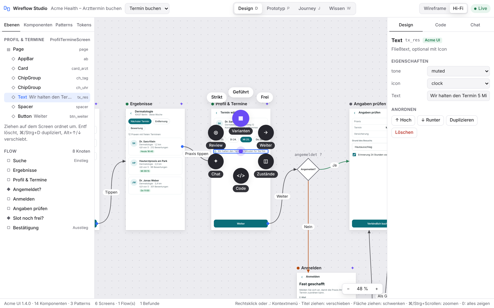
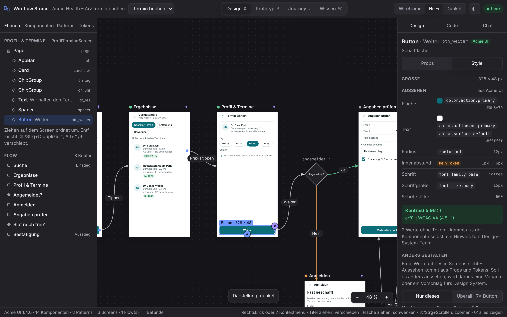
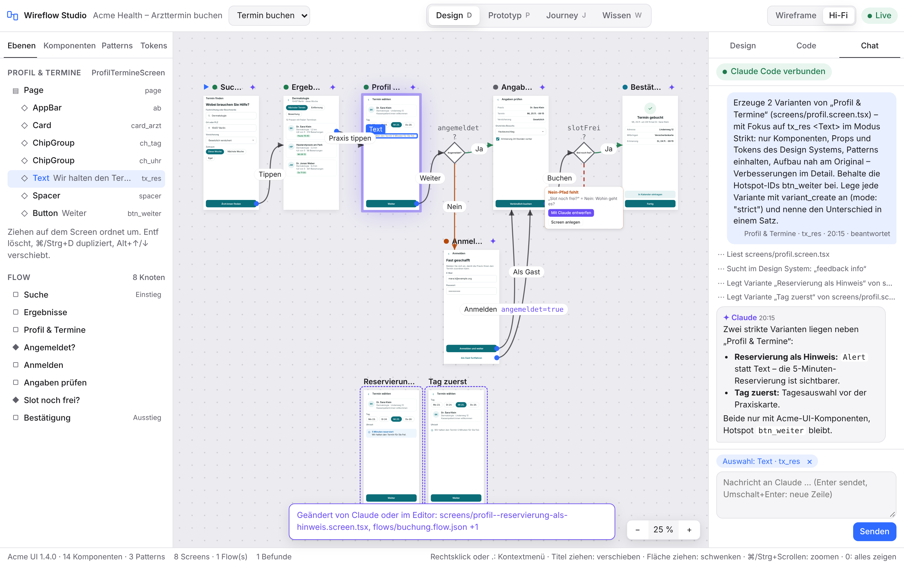

# Wireflow Studio – Plugin für Claude Code

Journeys, Wireflows und Prototypen aus **echtem Code des eigenen Design Systems** – mit einem Canvas im Browser, einer Wissensbasis zu Nutzer:innen und Claude als Co-Designer. Das Konzept dazu steht in [`concepts/wireflow-studio`](../../concepts/wireflow-studio/README.md); dieses Plugin setzt **Stufe 1 (Einzelmodus)** um.

```text
Design System verknüpfen → Wissen erfassen → Journey → Flow → Screens aus DS-Komponenten → Prototyp
```

## Installation

In Claude Code (ab 2.1):

```text
/plugin marketplace add arcade1080/awesome-uxe
/plugin install wireflow@awesome-uxe
```

Voraussetzungen im Projekt: Node.js ≥ 20, React-Design-System als npm-Paket (auch Workspace), `react`, `react-dom` und `esbuild` als (Dev-)Abhängigkeiten. Der Canvas bündelt Screens mit dem esbuild **des Projekts** – so rendern genau die Komponenten, die auch das Produkt nutzt.

## Schnellstart

```text
/wireflow:init @firma/ui        Projekt anlegen, Design System verknüpfen
/wireflow:research interviews/   Insights mit Belegen, Annahmen, offene Fragen
/wireflow:journey                Journey mit Pain Points und Wissensstand
/wireflow:flow                   Wireflow mit Entscheidungen und Fehlerpfaden
/wireflow:hifi                   Screens als Code aus DS-Komponenten
/wireflow:canvas                 Canvas öffnen: ansehen, anordnen, verbinden
/wireflow:prototype              Durchklicken, Testaufgaben aus Annahmen
/wireflow:review                 Quality Gates: Flow, DS, Patterns, A11y, Wissen
/wireflow:export spec            Mermaid, Spezifikation, Übergabe
```

Natürliche Sprache funktioniert genauso: „Gestalte den Fehlerfall für vergebene Termine nach dem Pattern Speichern“ oder – mit Auswahl im Canvas – „mach das Ausgewählte zur primären Aktion“.

## Beispiel ausprobieren

```bash
cd plugins/wireflow/examples/acme-health
npm install                       # esbuild, react, react-dom; Acme UI als Workspace
node ../../bin/wireflow serve --open
```

Das Beispiel enthält ein kleines, fiktives Design System (Acme UI: 14 Komponenten, Tokens, drei Patterns), Research-Wissen, eine Journey und einen Buchungs-Flow mit sechs Screens. Ein Pfad fehlt absichtlich („Slot noch frei?“ → Nein) – der Canvas zeigt ihn rot, der Prototyp meldet ihn, und im Inspector lässt er sich mit einem neuen Screen schließen.

## Was im Repository entsteht

```text
.wireflow/
├── project.json                 Name, Viewport, erlaubte Imports
├── ds/manifest.json             Komponenten, Props, Defaults, Intents, Richtlinien, Tokens, Regeln
├── ds/patterns/*.md             Pattern-Karten: wann welche Komponente, verlangte Zustände
├── knowledge/                   insights.json, assumptions.json, questions.json
├── research/                    Rohmaterial (pseudonymisiert), Testaufgaben
├── journeys/*.journey.json      Phasen, Emotion, Pain Points mit Belegen, Chancen
├── flows/*.flow.json            Screens, Entscheidungen, Kanten von Elementen zu Zielen
├── screens/*.screen.tsx         Screen-Module: React aus DS-Komponenten
├── screens/*.stories.tsx        Zustände als Storybook-Stories (CSF 3)
└── fixtures/*.ts                typisierte Testdaten
```

Alles ist Text und gehört ins Git: Reviews, Diffs und Branches funktionieren wie bei Code.

### Screen-Module

```tsx
import { Page, AppBar, Alert, Button } from '@acme/ui';
import { flow } from '@wireflow/runtime';

export function SlotVergebenScreen() {
  return (
    <Page data-wf="page" padding="space.4" gap="space.3">
      <AppBar data-wf="ab" title="Termin wählen" onBack={flow.back} />
      <Alert data-wf="al_vergeben" tone="danger" title="Termin gerade vergeben">Ihre Angaben bleiben erhalten.</Alert>
      <Button data-wf="btn_neu" variant="primary" size="lg" onPress={flow.trigger('btn_neu')}>Anderen Termin wählen</Button>
    </Page>
  );
}
```

Regeln: nur Komponenten aus dem Manifest, kein HTML, kein `style`/`className`, Props und Tokens laut Manifest, stabile `data-wf`-IDs. Der Canvas liest solche Module als Baum, ändert sie strukturiert (Einfügen, Verschieben, Props, Text) und schreibt sie deterministisch zurück; Ausdrücke in `{…}` bleiben unverändert erhalten. `@wireflow/runtime` liefert nur `flow.trigger(id)`, `flow.back` und `flow.vars` – im Produkt ersetzt ein Alias es durch den eigenen Router.

## Bausteine

| Baustein | Datei | Aufgabe |
|---|---|---|
| Skills | `skills/*/SKILL.md` | `/wireflow:init`, `ds`, `research`, `journey`, `flow`, `hifi`, `canvas`, `prototype`, `review`, `export`; Methodenwissen in `ux-methods` |
| Subagents | `agents/*.md` | `ds-curator`, `journey-analyst`, `flow-architect`, `ui-composer`, `ux-critic`, `research-scout` |
| MCP-Server | `.mcp.json` → `wireflow mcp` | 26 Werkzeuge: Projekt, DS, Journeys, Flows, Screens, Varianten, Wissen, Canvas und Chat, Export, Rückgängig; zugleich Kanal für den Chat im Canvas |
| Hooks | `hooks/hooks.json` | `SessionStart`: Projektstatus als Kontext; `PostToolUse`: prüft jede Datei unter `.wireflow/` – Fehler gehen an Claude zurück; `UserPromptSubmit` und `Stop`: wartende Nachrichten aus dem Canvas-Chat, falls kein Kanal läuft |
| Monitor | `plugin.json` → `experimental.monitors` | `canvas-chat`: stellt Chat-Nachrichten und Aufträge aus dem Canvas sofort in der Sitzung zu |
| Kanal | `plugin.json` → `channels` | optionaler zweiter Weg (Research Preview), still, solange der Monitor läuft |
| CLI | `bin/wireflow` | `init`, `serve`, `status`, `validate`, `lint`, `export`, `doctor` – im Plugin auf dem `PATH`, ohne Plugin für CI |
| Canvas | `src/canvas/` | lokaler Server (nur `127.0.0.1`, Token im Link) und Web-App ohne Build |

Keine Laufzeit-Abhängigkeiten: Das Plugin nutzt nur Node.js; React und esbuild kommen aus dem Projekt.

## Canvas



- **Design:** Screens als echte Komponenten auf einer unendlichen Fläche. Element anklicken → Inspector mit Props laut Manifest (Enums, Tokens, Text), Interaktion (Ziel im Flow), Richtlinien und Prüfung. Komponenten aus der Liste auf Screens ziehen oder mit „+“ einfügen; Elemente per Drag & Drop umordnen; Entf, ⌘/Strg+D, Alt+↑/↓, ⌘/Strg+Z. Screens am Titel verschieben. Kanten starten am auslösenden Element. Wireframe/Hi-Fi tauscht nur Tokens.
- **Prototyp:** derselbe Code, klickbar. Variablen steuern Entscheidungen; fehlende Pfade und unverbundene Elemente werden gemeldet; Klick ins Leere zeigt Hotspots.
- **Journey:** Phasen mit Emotionskurve, Pain Points mit Wissensstand und Beleg.
- **Wissen:** Wissensstand je Flow-Schritt, Insights mit Belegen, Annahmen nach Risiko, offene Fragen – jeweils mit „Genutzt in“.
- **Live:** Ändert Claude oder ein Editor eine Datei, aktualisiert sich der Canvas sofort und markiert die betroffenen Screens. Die Auswahl im Canvas liest Claude mit `canvas_selection`.
- **Rechte Spalte – Design · Code · Chat:** *Design* ist der Inspector, *Code* zeigt Screen-Modul und Stories mit markiertem Element, *Chat* ist das Gespräch mit Claude – die Auswahl geht als Kontext mit.
- **Design-Panel mit Props | Style:**
  - **Props** – was die Komponente ist und tut: Segment-Schalter für Auswahlwerte, Schalter für Ja/Nein, Standardwerte aus dem Manifest („Standard: md“), ↺ zum Zurücksetzen, *Tauschen gegen …* (Komponenten mit ähnlichem Zweck zuerst, passende Props bleiben), Inhalt und Slots, Interaktion, Anordnen, Richtlinien.
  - **Style** – wie sie aussieht, nur über Tokens: Größe, Token-Skalen für Abstände, die tatsächlich verwendeten Tokens aus dem Rendering (Fläche, Text, Rahmen, Radius, Innenabstand, Schrift), Kontrast nach WCAG und Werte ohne Token als Hinweis fürs DS-Team.
  - **Anders gestalten:** *Nur dieses* oder *Überall* (alle Instanzen) – geht als Auftrag an Claude: eine Variante oder ein Vorschlag fürs Design System statt freier Werte.
- **Änderungsliste** unten im Design-Panel: jede Änderung aus Canvas und von Claude mit „vorher → nachher“; × macht eine einzelne rückgängig, auch wenn danach weitere Änderungen kamen.
- **Griffe an der Auswahl:** Größe (B × H), „+“ fügt eine Komponente darunter ein (mit Suche), der Pfeil ↗ zieht eine Verbindung auf einen anderen Screen oder eine Entscheidung.
- **Dunkelmodus:** Das Werkzeug folgt dem System und lässt sich umschalten (◐ · ☾ · ☀). Definiert das Design System einen Token-Modus `dark`, zeigt „Dunkel“ auch die Screens im Dunkelmodus.
- **Kontextmenü** (Rechtsklick auf Screen oder Element, Taste `.`, ✦ am Titel):
  - **Varianten:** *Strikt* (nur DS, Aufbau nah am Original), *Geführt* (DS-Komponenten, Aufbau frei), *Frei* (kreativ, Lücken benannt).
  - **Review:** aus Sicht einer Persona der Journey, nach Heuristiken, Barrierefreiheit, Texten oder Design System.
  - **Weiter:** neuer oder bestehender Screen als Ziel.
  - **Zustände:** Leer, Fehler, Laden, Erstnutzung, Offline.
  - **Code**, **Chat**.
- **Lückenkarten:** Fehlende Pfade, Sackgassen, unerreichbare Screens und fehlende Hotspots stehen als Karte am Ort – mit „Mit Claude entwerfen“ oder einer direkten Aktion.
- **Varianten** liegen gestrichelt unter dem Original (`screens/<name>--<variante>.screen.tsx`), mit Modus, Begründung und DS-Prüfung. *Tauschen* macht eine Variante zum Screen im Flow, *Verwerfen* löscht sie (rückgängig mit ⌘/Strg+Z).



### Chat mit der laufenden Claude-Sitzung



Öffnet Claude den Canvas (`/wireflow:canvas`), ist der Chat mit genau dieser Sitzung verbunden. Werkzeug-Aufrufe erscheinen als Zeilen im Chat, der bearbeitete Screen leuchtet violett. Zugestellt wird auf drei Wegen – der Chat zeigt oben, welcher gerade greift:

1. **Plugin-Monitor `canvas-chat` (Standard):** Claude Code startet ihn mit der Sitzung (`experimental.monitors` in `plugin.json`). Er druckt jede neue Nachricht als Zeile; Claude Code reicht sie als Benachrichtigung an Claude weiter – Claude reagiert sofort, ohne Flag und auch über Amazon Bedrock oder Vertex (dort ab Claude Code 2.1.310). Monitore laufen nur interaktiv, nicht mit `-p`.
2. **Kanal (Research Preview, optional):** mit `claude --dangerously-load-development-channels plugin:wireflow@awesome-uxe` (Anmeldung über claude.ai oder Console-API-Schlüssel). Läuft der Monitor, bleibt der Kanal still – nichts kommt doppelt an.
3. **Hooks (Rückfall ohne Monitor):** `UserPromptSubmit` gibt offene Nachrichten beim nächsten Prompt mit, `Stop` lässt Claude sie am Ende eines Schritts noch erledigen. Gelesene, aber unbeantwortete Nachrichten hält der Stop-Hook immer offen, bis Claude mit `canvas_reply` antwortet.

Die Nachrichten liegen in einer Inbox außerhalb des Repos (nur für die Person). Ein mit `wireflow serve` gestarteter Canvas hat keine Sitzung; dort ist der Chat deaktiviert.

## Entwicklung

```bash
cd plugins/wireflow
npm test                          # node:test – Code-Brücke, Flows, MCP, Canvas-Server
claude plugin validate .          # Plugin-Manifest prüfen
```

## Grenzen von Stufe 1

- Einzelmodus: ein Canvas pro Rechner; Zusammenarbeit läuft über Git. Team-Server, gemeinsame Räume und Kommentare sind [Phase 2 des Konzepts](../../concepts/wireflow-studio/README.md).
- Renderer: React mit esbuild. Andere Frameworks (Vue, Web Components) folgen über Renderer-Adapter.
- Die Code-Brücke versteht eine TSX-Teilmenge (eine exportierte Screen-Funktion mit `return (<…>)`). Alles andere bleibt als Code-Block erhalten.
- Figma-Export, visuelle Diffs und Screenshots im Review sind noch nicht enthalten.
