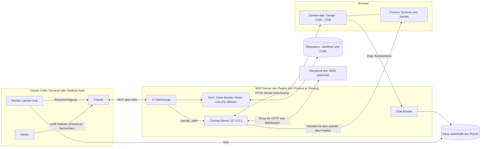
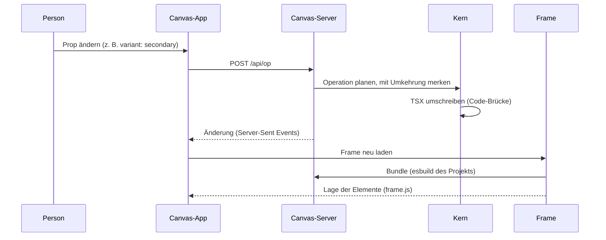
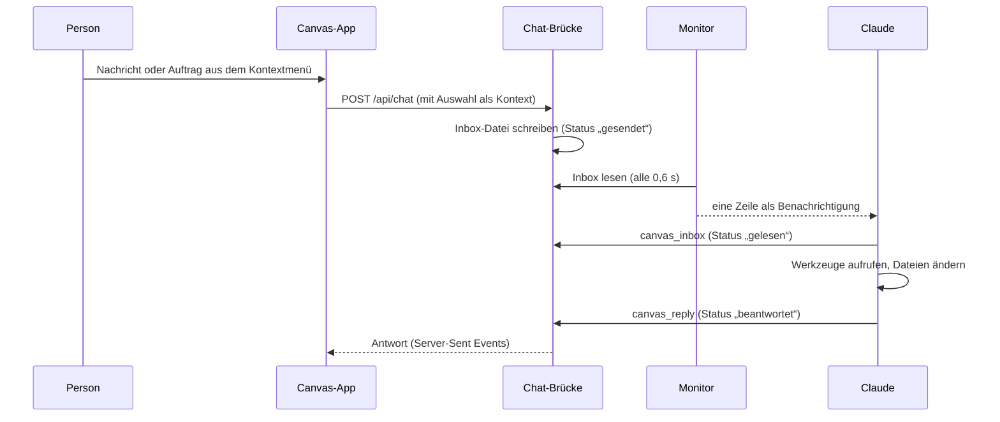
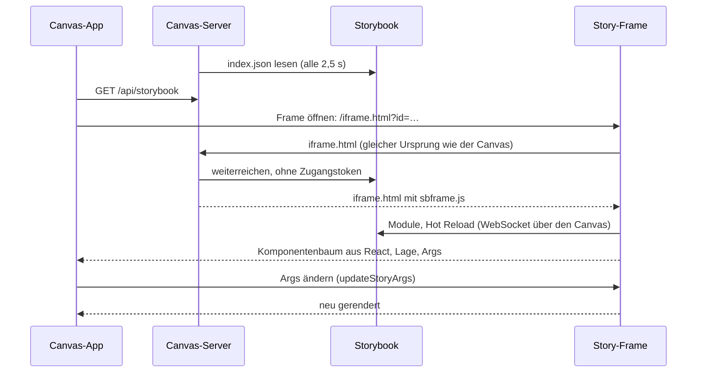

# Architektur von Wireflow Studio

Wireflow Studio ist ein Plugin für Claude Code. Alles läuft auf dem Rechner der Person: Claude Code im Terminal (oder in der Desktop-App), der MCP-Server des Plugins, ein Canvas-Server auf `127.0.0.1` und der Canvas im Browser. Die Quelle der Wahrheit ist das Repository – `.wireflow/` und der Code des Projekts. Der Canvas ist eine Ansicht darauf, kein eigener Speicher.

## Überblick

## Bausteine

| Baustein | Ort | Läuft als | Aufgabe |
|---|---|---|---|
| Skills und Subagents | `skills/`, `agents/` | Anweisungen in Claude Code | Arbeitsabläufe: init, research, journey, flow, hifi, canvas, prototype, review, export |
| MCP-Server | `src/mcp/server.js`, `tools.js` | Prozess je Sitzung, JSON-RPC über stdio | Werkzeuge für Projekt, Design System, Journeys, Flows, Screens, Varianten, Wissen, Canvas, Chat, Storybook, Export; meldet sich zusätzlich als Kanal |
| Kern | `src/core/` | Bibliothek | Code-Brücke (TSX-Teilmenge lesen und unverändert wieder schreiben), Screen- und Flow-Operationen mit Rückgängig, Lint gegen das DS-Manifest, Tokens (DTCG → CSS-Variablen), Wissensstand, Storybook-Index |
| Canvas-Server | `src/canvas/server.js` | im MCP-Prozess (`canvas_open`) oder allein (`wireflow serve`) | Web-App ausliefern, Projekt-API, Live-Ereignisse, Screens mit dem esbuild des Projekts bündeln, Dateien beobachten, Storybook durchreichen |
| Canvas-App | `src/canvas/app/` | Browser, ohne Build | Fläche mit Frames, Inspector (Props · Style), Code, Chat, Kontextmenü, Prototyp, Journey, Wissen |
| Frame-Skripte | `app/frame.js`, `app/sbframe.js` | in jedem Frame | melden Lage und Größe der Elemente, Fehler und – bei Storybook – Komponentenbaum und Args |
| Laufzeit | `src/runtime/` (`@wireflow/runtime`) | in den Screen-Modulen | Hotspots im Prototyp (`flow.trigger(id)`); im Produkt ersetzt durch den Router |
| Monitor | `plugin.json` → `experimental.monitors` | Hintergrundprozess, von Claude Code gestartet | stellt Nachrichten aus dem Canvas-Chat in der laufenden Sitzung zu |
| Hooks | `hooks/hooks.json` | von Claude Code aufgerufen | `SessionStart`: Projektstatus; `PostToolUse`: prüft Dateien unter `.wireflow/`; `UserPromptSubmit` und `Stop`: Rückfall für den Chat |
| CLI | `bin/wireflow` | Terminal, CI | `init`, `serve`, `status`, `validate`, `lint`, `export`, `doctor` |

## Wege durch das System

### Bearbeiten im Canvas

Jede Änderung landet als Code im Screen-Modul. Die Änderungsliste merkt sich die Umkehrung, so lässt sich jede einzelne Änderung zurücknehmen.

### Claude arbeitet

Claude ruft Werkzeuge wie `screen_edit`, `flow_edit` oder `variant_create` auf. Der Kern schreibt die Dateien, der Canvas-Server bemerkt die Änderung und schickt sie an die App; der bearbeitete Screen leuchtet, der Werkzeug-Aufruf erscheint im Chat. Bearbeitet Claude Dateien direkt, prüft der Hook `PostToolUse` sie gegen Manifest und Regeln und meldet Fehler zurück.

### Chat im Canvas → Claude im Terminal

Drei Wege, von denen immer genau einer zustellt: **Monitor** (Standard, auch über Bedrock und Vertex), **Kanal** (Research Preview, nur ohne Monitor) und **Hooks** (Rückfall: beim nächsten Prompt bzw. am Ende eines Schritts). Ein Herzschlag zeigt, ob der Monitor läuft. Der Stop-Hook lässt Claude nicht aufhören, solange eine gelesene Nachricht unbeantwortet ist.

### Storybook-Brett

Storybook rendert die Stories selbst – mit Decorators, Providern und Styles des Projekts. Weil der Canvas Storybook unter seinem eigenen Ursprung durchreicht, kann er die Frames direkt lesen (Komponentenbaum aus den React-Fibers, berechnete Styles für den Style-Reiter). Änderungen am Code macht Claude im Projekt; Storybook lädt sie neu.

## Daten

| Was | Wo | Im Repository |
|---|---|---|
| Projekt, Manifest, Patterns | `.wireflow/project.json`, `ds/manifest.json`, `ds/patterns/*.md` | ja |
| Screens und Zustände | `.wireflow/screens/*.screen.tsx`, `*.stories.tsx` (CSF, laufen auch in Storybook) | ja |
| Flows, Journeys, Wissen, Entscheidungen | `.wireflow/flows/`, `journeys/`, `knowledge/`, `decisions/` | ja |
| Auswahl im Canvas | `.wireflow/.canvas-state.json` | nein (ignoriert) |
| Chat-Inbox, Herzschlag des Monitors | Temp-Ordner des Systems, `wireflow-<uid>/inbox/` | nein |
| Änderungsliste, Rückgängig | Speicher des MCP-Prozesses | nein |
| Storybook-Pins und -Positionen | `localStorage` des Browsers | nein |

## Sicherheit

- **Nur lokal:** Der Canvas lauscht ausschließlich auf `127.0.0.1`. Zugang nur über den Link mit Token; daraus wird ein HttpOnly-Cookie (`SameSite=Strict`).
- **Prüfungen:** `Host` gegen DNS-Rebinding, `Origin` für schreibende Anfragen und WebSockets.
- **Storybook:** nur Adressen auf diesem Rechner; das Token-Cookie des Canvas wird nicht weitergegeben. Story-Code läuft im Ursprung des Canvas – wie die Screens, es ist der Code des Projekts.
- **Dateien:** `/api/file` liefert nur Quelltext aus dem Projekt (ohne `node_modules`, höchstens 1 MB).
- **Chat:** Die Inbox liegt außerhalb des Repos mit Rechten nur für die Person (`0600`).
- **Abhängigkeiten:** Das Plugin hat keine; React und esbuild kommen aus dem Projekt.

## Leitgedanken

1. **Echter Code statt Zeichnungen.** Screens bestehen aus den Komponenten des Design Systems; Prüfungen laufen gegen dessen Manifest.
2. **Das Repository ist die Quelle.** Canvas, Claude und Editor arbeiten an denselben Dateien; Zusammenarbeit läuft über Git.
3. **Claude Code ist der Motor.** Der Canvas schickt Aufträge in die laufende Sitzung, statt eine eigene KI mitzubringen.
4. **Bestehendes nutzen.** Storybook-Stories, DTCG-Tokens und MCP – ohne Migration.
